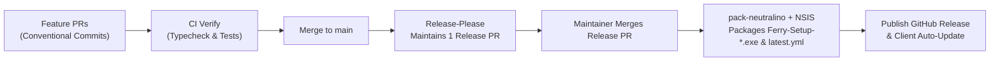

# CLAUDE.md

This file provides guidance to Claude Code (claude.ai/code) when working with code in this repository.

## What this is

Ferry is a lightweight WinSCP alternative: a Neutralinojs (`WebView2`) + Node.js sidecar + Vue 3 desktop SFTP client (dual-pane file browser, recursive transfer queue with bandwidth cap, live remote log tail via `tail -F`, remote archive extract/compress, browser-like multi-session site tabs, an interactive SSH Terminal per site, command palette, light/dark theme). SSH/SFTP only — no FTP/FTPS/SCP.

**For anything beyond this file** — full directory map, every convention, and a running list of
gotchas that have already cost a session real time — read
[.claude/PROJECT_MAP.md](.claude/PROJECT_MAP.md) first. It is actively maintained; update it (not
just this file) whenever you add a convention or hit a new gotcha worth remembering.

## Commands

```bash
npm install --registry=https://registry.npmjs.org   # always pass --registry explicitly on this machine
npm run dev          # build renderer + sidecar and launch Neutralinojs (neu run)
npm run typecheck    # vue-tsc --build + tsc --build tsconfig.node.json, no emit — run before every build
npm run build        # build both renderer (out/renderer/) and sidecar (out/sidecar/index.cjs)
npm run package      # build + package Neutralino portable zip, NSIS installer (Ferry-Setup-*.exe), and latest.yml
npm run smoke:neutralino # packaged NSIS upgrade & live SSH/SFTP/PTY/Tail smoke test
npm test             # vitest run (single pass)
npm run test:watch   # vitest watch mode
```

Run a single test file: `npx vitest run src/main/ssh/shellEscape.test.ts`. Run by name:
`npx vitest run -t "pattern"`.

Most tests are pure-logic unit tests needing no server. A handful
(`RemoteShell.integration.test.ts`, `SessionManager.integration.test.ts`,
`SessionManager.jumphost.integration.test.ts`, `TransferQueue.integration.test.ts`) are real-server
integration tests against a local Docker SFTP/SSH container (command in
`RemoteShell.integration.test.ts`'s file header); each self-skips with a console warning if the
container isn't running. `vitest.config.ts` sets `fileParallelism: false` — this is load-bearing
(shared on-disk `known_hosts.json` state across integration suites), not a style choice.

## Architecture

- **Neutralinojs + Node.js sidecar host**: `src/main` logic runs in the bundled Node.js v22 sidecar (`src/sidecar/wsExtension.ts` + `createNodeHost` + DPAPI `src/main/host/dpapiKey.ts`), with `src/renderer` running inside Neutralino's WebView2 shell and communicating via `src/renderer/src/bridge/neutralinoApi.ts` (`window.api`). `system:startDrag` (native OS drag-out) is an accepted platform no-op, while external OS drag-in stages up to 16 MB via `fs:local:stage-drop` with automatic post-upload cleanup.
- **Sidecar + Shell split**: `src/sidecar` + `src/main` (Node context — SSH/SFTP, filesystem, transfer queue, tail, terminal, archive, sites, auto-updater via `SidecarUpdater`, IPC handlers), `src/renderer` (Vue 3 + Pinia UI, using `neutralinoApi.ts` for Neutralino native dialogs/window controls and sidecar WebSocket RPC for backend channels).
- **IPC contract.** Define channel names and payloads in `src/shared/contract.ts`. The renderer bridge forwards typed requests to the sidecar's authenticated loopback WebSocket.
- **IPC handlers.** Register them through `src/main/ipc/registerSidecar.ts`. The `handle()` wrapper in `ipc/envelope.ts` returns `{ok:true,data}` or `{ok:false,code,message}`. The sidecar broadcasts events through the host adapter. The renderer subscribes with `window.api.on(channel, cb)`.
- **One `RemoteShell` (wraps one `ssh2.Client`) per connection**, owned by the `SessionManager`
  singleton and keyed by a renderer-issued `sessionId` (not a saved site id — the same site can
  have multiple concurrent sessions/tabs). `TailManager`, `TerminalManager`, and `TransferQueue`
  are separate singletons that look up a session's `RemoteShell` rather than owning connections
  themselves.
- **`main/fs/` services (`LocalFsService`, `RemoteFsService`) are plain exported functions, not
  classes** — everything else stateful in `main/` (`SessionManager`, `SiteStore`, `TailManager`,
  `TransferQueue`, `TerminalManager`) is a `getInstance()` singleton.
- **Renderer state is one Pinia store per domain** in `src/renderer/src/stores/`: `sites`,
  `sessions` (browser-like open-site tabs), `localFs` (global), `remoteFs` (keyed per `sessionId`
  so each tab has independent listings/selection), `transferQueue`, `tailStreams`,
  `terminalStreams` (xterm.js instances live outside Pinia's reactive state, in a module-scoped
  `Map`), `ui` (localStorage-persisted display prefs), `settings` (thin wrapper over main-process
  `AppSettingsStore`), `ipcActivity` (drives the global busy indicator).
- **Secrets never cross the IPC boundary decrypted.** `SiteStore` only ever returns
  `hasPassword`/`hasPassphrase` booleans to the renderer; the Windows sidecar decrypts saved secrets in memory with its DPAPI-backed key when a connection needs them.
- No `vue-router` — single window, view/tab switching is plain reactive state.

See PROJECT_MAP.md's "Conventions" and "Where to go for X" sections before making any nontrivial
change — they cover things like the exec-first recursive delete, optimistic store patching instead
of full reloads, the drag-and-drop dual-mechanism split, host-key TOFU verification, and the
real-2FA prompt flow, in more depth than belongs here.

## Design docs and plans (historical, not authoritative for current state)

- Architecture Decision Records live in [docs/adr/](docs/adr/) — notably [ADR-0001: Neutralinojs + Node.js Sidecar Host Migration](docs/adr/0001-neutralinojs-migration.md).
- `.claude/architecture/` holds the original backend/frontend design docs written before implementation began; `.claude/plan/` holds every approved feature-round implementation plan in sequence. Both are useful for *why* something was built a certain way, but the code and PROJECT_MAP.md are the source of truth for current behavior — plans describe intent at the time, not necessarily what shipped.

## CI/CD & Release Workflow (Release Please)

For full architectural details, see [docs/ci-cd-release-workflow.md](docs/ci-cd-release-workflow.md).

- **Branch Protection**: `main` is protected. CI never pushes directly to `main`.
- **Commit Convention**: Always use **Conventional Commits** (`feat:`, `fix:`, `perf:`, `chore:`, `docs:`, `refactor:`, `test:`).
  - `feat:` triggers a **minor** version bump (`0.x.0`).
  - `fix:` / `perf:` triggers a **patch** version bump (`0.0.x`).
  - Breaking changes (`feat!:` or `BREAKING CHANGE:`) trigger a **major** bump (`x.0.0`).
- **Workflow Architecture**:
  - `.github/workflows/ci.yml`: Runs on PRs and pushes to `main` for verification (`typecheck`, `test`, `build`).
  - `.github/workflows/release.yml`: Runs Google `release-please` on `main`. It maintains a single accumulating Release PR (`chore: release X.Y.Z`) with updated `package.json`, `VERSION`, and `CHANGELOG.md`.
  - **Cutting a Release**: Merging the Release PR automatically cuts the GitHub release and triggers the Windows runner to build `Ferry-Setup-*.exe`, `Ferry-Portable-*-win-x64.zip`, and `latest.yml` and attach them to the release.
  - Do NOT manually hack versions in `package.json` on `main` or add ad-hoc version-bump loops. Releases are managed through the Release PR.



## Development Rules

### Git Commit Attribution
- Never include AI attribution in Git commit messages.
- Do not append `Co-Authored-By`, `Generated with`, or any AI-related trailers.
- Commit messages must contain only the conventional commit subject and an optional description.
- Before committing, verify that the commit message contains no AI attribution.
- This rule applies to all agents, subagents, and automated commits.
