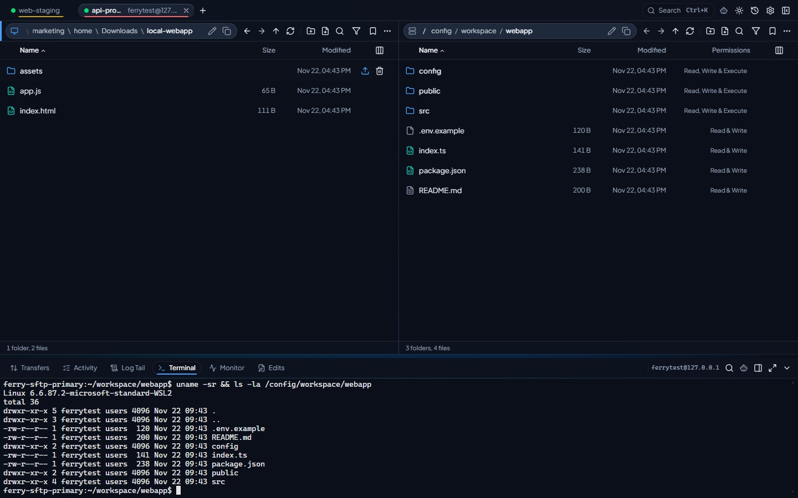
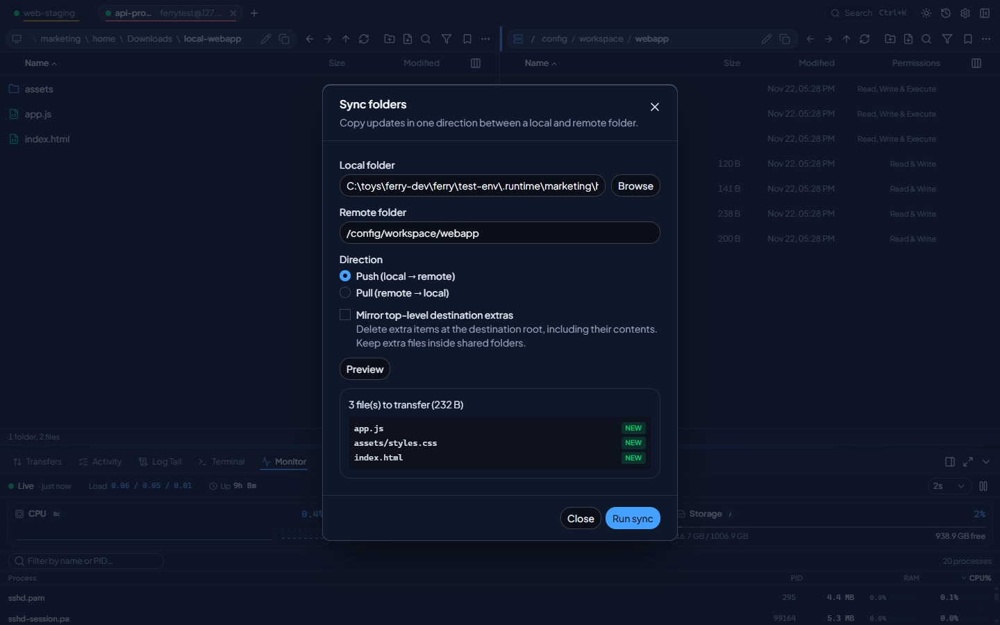
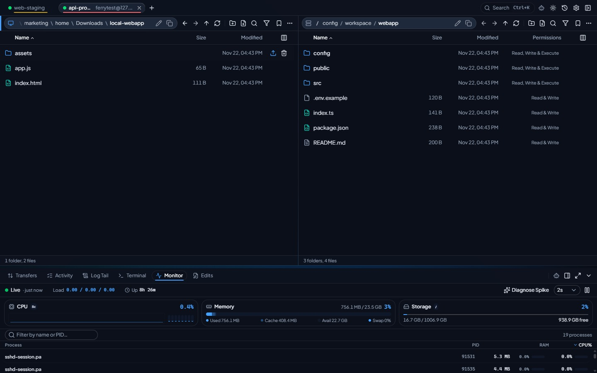
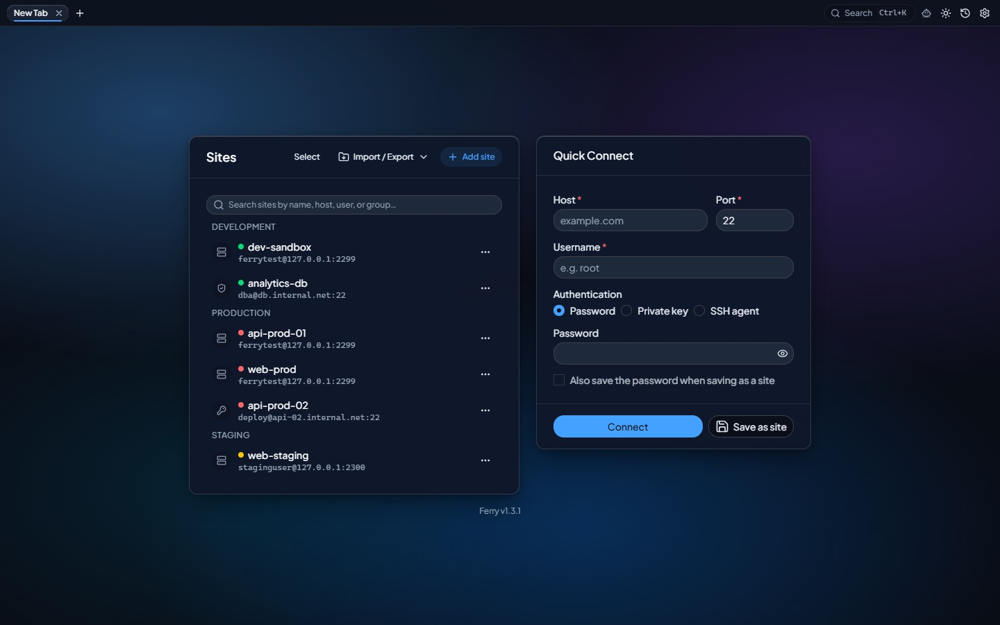
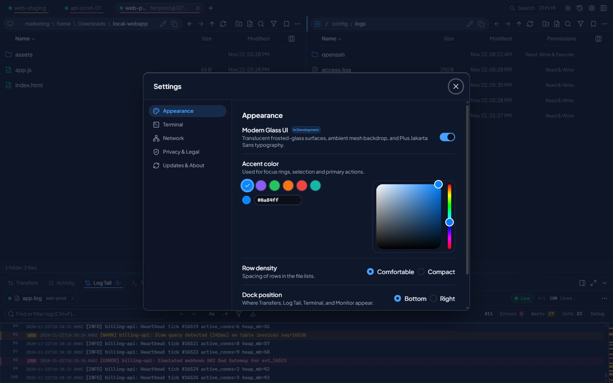

# Ferry

A lightweight WinSCP alternative: a Neutralinojs + Vue 3 desktop SFTP client. SSH/SFTP only — no
FTP/FTPS/SCP.

## Features

- Dual-pane local/remote file browser with sort, multi-select, quick search (`Ctrl+F`),
  per-connection [File Visibility Filters](docs/file-visibility-filters.md) (include/exclude globs),
  and a right-click context menu (transfer, tail, extract, compress, rename, copy path, delete, chmod)
- Recursive folder transfers (upload/download whole directory trees), with retry on failure and an
  app-wide bandwidth cap
- OS drag-and-drop: drop files from Explorer onto the remote pane to upload, or drag rows out to
  Explorer/other apps
- Live remote log tailing (`tail -F`) and a text/archive file preview dialog
- Remote archive extract/compress, and local compress-to-zip
- Browser-like multi-session site tabs — connect to multiple servers at once, each with its own
  session, restored (as picker tabs) across restarts
- An interactive SSH Terminal per site, backed by `ssh2`'s PTY shell and `@xterm/xterm`
- A live remote resource Monitor (CPU/memory/load, disk usage, top processes) and an Activity dock
  tab showing progress for long-running operations
- Host-key verification (trust-on-first-use), SSH-agent and jump-host (bastion) authentication,
  real keyboard-interactive/2FA prompts
- Import existing WinSCP/PuTTY saved sessions (passwords are never imported)
- Command palette (Ctrl/Cmd+K), light/dark theme

## Screenshots

**Dual-pane file browser** — local and remote side by side, with sort, multi-select, and per-file permissions.



**One-way folder sync** — mirror a local folder to (or from) a remote one.



**Built-in resource monitor** — live CPU, memory, disk usage, and a top-processes table for the connected server.



| **Flexible connections** — password, private key, or SSH agent auth, with jump-host and proxy support. | **Customizable** — accent color, transfer bandwidth cap, and default proxy settings. |
|---|---|
|  |  |

## Installation

Ferry is currently Windows-only (Windows 10/11, 64-bit). Install via any of these official channels:

1. **Microsoft Store (Recommended):** Install from the
   [Microsoft Store listing](https://apps.microsoft.com/detail/9PJPWK568P53) (`ms-windows-store://pdp/?productid=9PJPWK568P53`)
   for a 1-click signed MSIX install with no Windows SmartScreen warning and automatic Store updates.
2. **GitHub Releases (`Ferry-Setup-*.exe` or `Ferry-Portable-*-win-x64.zip`):** Download the latest
   Windows installer or zero-install portable archive from the public
   [Ferry releases](https://github.com/ThienNg65/ferry-release/releases) page.

Development takes place in this source repository, while packaged releases and update metadata are
published to `ferry-release` by GitHub Actions. Existing installations first need a bridge release
published to the original `ferry` feed.

The direct GitHub `.exe` installer is currently **unsigned**, so Windows SmartScreen will warn on
first run — this is expected, not a sign of tampering (use the Microsoft Store build above if you
prefer a signed install). Ferry's release pipeline (`.github/workflows/release.yml`) has a dormant
signing stage ready to go live via [SignPath](https://signpath.io)'s free open-source Authenticode
signing program the moment that application is approved; see
`.claude/plan/ferry-smartscreen-signing-plan.md` for the full plan.

## Development

```bash
npm install --registry=https://registry.npmjs.org
npm run dev          # build and launch Neutralinojs dev shell
npm run typecheck    # type-check the whole project, no emit
npm run build        # build renderer & Node sidecar -> out/
npm run package      # build + package Ferry-Setup-*.exe (NSIS), Ferry-Portable-*-win-x64.zip, latest.yml
npm test             # vitest run (single pass)
```

See [CLAUDE.md](CLAUDE.md) and [.claude/PROJECT_MAP.md](.claude/PROJECT_MAP.md) for architecture,
conventions, and development notes.

## Releasing

CI lives in `.github/workflows/ci.yml` and runs type checking, tests, and a build on each
push/PR to `main`. Release Please handles versioning and source release tags through
`.github/workflows/release.yml`. Its Windows packaging job builds and (when configured with a
scoped `PUBLIC_RELEASE_TOKEN`) uploads `Ferry-Setup-*.exe`, `Ferry-Portable-*-win-x64.zip`, and `latest.yml` to
`ThienNg65/ferry-release`, which hosts public downloads and auto-updates. During migration,
the same assets are uploaded to the legacy `ferry` release for existing installations.
Note: `v0.23.1` Neutralino preview users must run `Ferry-Setup-0.24.0.exe` manually once (preserving `%APPDATA%\Ferry`); `v0.24.0+` Neutralino users update automatically.
See [repository migration instructions](docs/REPOSITORY_MIGRATION.md) before switching visibility.

Signing goes through a currently-dormant SignPath stage: every step in that stage is gated on the
`SIGNPATH_ORGANIZATION_ID` repo variable, which isn't set yet, so today it's a no-op and every
release ships unsigned. Once a SignPath OSS account is approved and that variable (plus its
matching secrets) are added, the workflow uploads the built installer as an artifact, submits it to
SignPath for Authenticode signing, and regenerates `latest.yml`'s hash/size before publishing —
without touching anything else in this flow.

## Legal, Privacy & Licenses

- **License:** [MIT](LICENSE) — third-party notices in [THIRD_PARTY_LICENSES.txt](THIRD_PARTY_LICENSES.txt)
- **Privacy Policy:** [PRIVACY.md](PRIVACY.md) (local-first; zero telemetry, cookies, analytics, or AI training)
- **Terms of Service:** [TERMS.md](TERMS.md)
- **Maintainer Contact:** ThienNg65 via [GitHub Issues](https://github.com/ThienNg65/ferry/issues) or [GitHub Security Advisories](https://github.com/ThienNg65/ferry/security)
