# CI/CD & Release Engineering Workflow

This document explains the CI/CD pipeline and release engineering architecture for **Ferry**.

---

## 1. Overview & Core Philosophy

Ferry is an Electron desktop application. Desktop releases are **immutable client deployments** accompanied by auto-update metadata (`latest.yml`). 

To guarantee safety, predictability, and compliance with GitHub branch protection:
- **Zero CI Direct-Pushes to `main`**: CI workflows never commit or push back to `main`.
- **Pre-Release Versioning via Google Release Please**: Versions and changelogs are updated *before* release via an automated, accumulating Release PR.
- **Human-Gated Releases**: Desktop installers (`.exe`) are packaged and published only when a maintainer merges the Release PR.
- **Fast PR Feedback**: Normal feature PRs only run fast verification (`typecheck`, `test`, `build`); heavy Windows packaging runs only when publishing a release.

---

## 2. Visual Architecture & Workflow

```mermaid
flowchart TD
    classDef dev fill:#e0f2fe,stroke:#0284c7,stroke-width:2px,color:#0369a1;
    classDef ci fill:#fef3c7,stroke:#d97706,stroke-width:2px,color:#92400e;
    classDef bot fill:#f3e8ff,stroke:#9333ea,stroke-width:2px,color:#6b21a8;
    classDef release fill:#dcfce7,stroke:#16a34a,stroke-width:2px,color:#15803d;

    subgraph Phase1["1. Feature Development & PR"]
        A["Developer creates feature branch"]:::dev --> B["Commit with Conventional Commits\n(feat: ..., fix: ...)"]:::dev
        B --> C["Open Pull Request to 'main'"]:::dev
        C --> D["ci.yml runs 'verify'\n- Typecheck\n- Vitest suite\n- electron-vite build"]:::ci
        D -->|Checks pass & Review approved| E["Merge PR into 'main'"]:::dev
    end

    subgraph Phase2["2. Automated Release PR Management (Release Please)"]
        E --> F["release.yml triggers on 'main'"]:::ci
        F --> G["'release-please' action runs (ubuntu-latest)\n- Inspects commits since last release\n- Determines version bump (feat=minor, fix=patch)"]:::bot
        G --> H{"Release PR already open?"}:::bot
        H -->|Yes| I["Update existing Release PR\n(Appends changelog notes & bumps version)"]:::bot
        H -->|No| J["Open single Release PR\n'chore: release X.Y.Z'\n(Updates CHANGELOG.md, package.json, VERSION)"]:::bot
        I --> K["Team continues normal development\n(Additional PRs merge smoothly)"]:::dev
        J --> K
    end

    subgraph Phase3["3. Release Publishing (Human Gated)"]
        K -->|When ready to ship to users| L["Maintainer merges the Release PR"]:::release
        L --> M["release.yml runs on 'main'"]:::ci
        M --> N["'release-please' detects Release PR merged\n- Creates Git Tag 'vX.Y.Z'\n- Creates GitHub Release with release notes\n- Outputs release_created = true"]:::bot
        N --> O["'publish-assets' job runs (windows-latest)"]:::ci
        O --> P["electron-builder packages Windows desktop app\n(dist/Ferry-Setup-*.exe, latest.yml, *.blockmap)"]:::ci
        P --> Q["Upload assets to GitHub Release via 'gh release upload'"]:::release
        Q --> R["Installed Ferry clients detect 'latest.yml'\nand prompt users to auto-update"]:::release
    end
```

---

## 3. Conventional Commits Standard

Release Please relies on [Conventional Commits](https://www.conventionalcommits.org/) to automatically decide whether to bump the **major**, **minor**, or **patch** version, and to categorize entries in `CHANGELOG.md`.

| Commit Prefix | SemVer Impact | Changelog Section | Example |
| :--- | :--- | :--- | :--- |
| `feat:` | **Minor** (`0.x.0`) | Features | `feat(sites): add JSON export for saved sites` |
| `fix:` | **Patch** (`0.0.x`) | Bug Fixes | `fix(terminal): prevent cursor lock on pane switch` |
| `perf:` | **Patch** (`0.0.x`) | Performance Improvements | `perf(log): virtualize tail buffer above 5000 lines` |
| `docs:` | None (unless configured) | Documentation | `docs(readme): update installation guidance` |
| `refactor:` | None | Code Refactoring | `refactor(ipc): simplify envelope serialization` |
| `test:` | None | Tests | `test(sites): add test for DPAPI credential encryption` |
| `chore:` | None | Miscellaneous Chores | `chore(deps): update electron to 34.0.0` |
| `BREAKING CHANGE:` or `!` | **Major** (`x.0.0`) | Breaking Changes | `feat!: redesign entire IPC contract protocol` |

> [!TIP]
> If a pull request contains multiple commits, ensure the **PR Title** or the **Squash & Merge commit message** follows Conventional Commits format, as Release Please reads the commits that land on `main`.

---

## 4. Workflows Breakdown

### `ci.yml` (Validation Workflow)
- **Trigger**: Every pull request targeting `main`, and every direct push to `main`.
- **Runner**: `windows-latest`
- **Steps**:
  1. `actions/checkout@v4`
  2. `./.github/actions/setup-node-deps`
  3. Run `npm run typecheck`, `npm test`, `npm run build`, `npm run package`, and `npm run smoke:neutralino`
  4. `npm run typecheck`
  5. `npm test`
  6. `npm run build`
- **Permissions**: Read-only (`contents: read`).

### `release.yml` (Release Workflow)
- **Trigger**: Push to `main`.
- **Job 1: `release-please` (ubuntu-latest)**:
  - Runs `googleapis/release-please-action@v4` using `release-please-config.json` and `.release-please-manifest.json`.
  - Maintains the open Release PR with updated `package.json`, `package-lock.json`, `VERSION`, and `CHANGELOG.md`.
  - When the Release PR merges, creates the git tag and GitHub Release, setting `release_created = true`.
- **Job 2: `publish-assets` (windows-latest)**:
  - Runs only if `release_created == true`.
  - Checks out the tagged commit.
  - Builds and packages Windows artifacts via `npx electron-builder --publish never`.
  - *(Optional / Dormant)* Submits for Authenticode signing if `vars.SIGNPATH_ORGANIZATION_ID` is set.
  - Attaches `dist/Ferry-Setup-*.exe`, `dist/latest.yml`, and `dist/*.blockmap` to the newly created GitHub Release using `gh release upload`.

---

## 5. Configuration Files

### `release-please-config.json`
Specifies package release type (`node`), tracks the extra plain-text file `VERSION`, and maps commit types to human-readable changelog headings.

### `.release-please-manifest.json`
The single source of truth for current released version (e.g. `{"." : "0.14.15"}`). Release Please uses this manifest rather than scanning remote git tags, preventing any historical tag inconsistencies from corrupting SemVer.

---

## 6. Required GitHub Repository Settings

To allow `release-please` to manage pull requests automatically:
1. Navigate to **Settings** → **Actions** → **General** in the GitHub repository.
2. Under **Workflow permissions**, ensure **"Allow GitHub Actions to create and approve pull requests"** is checked.
3. If your GitHub organization restricts this permission, ensure `secrets.RELEASE_TOKEN` (a Personal Access Token with `repo` scope) is configured in repository secrets.
