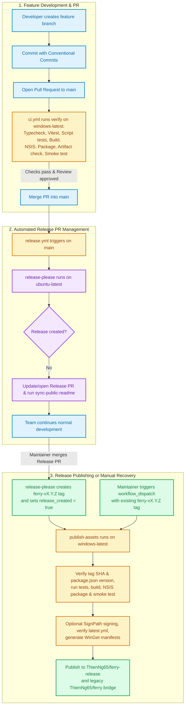

# CI/CD & Release Engineering Workflow

This document describes the CI/CD pipeline and release process for Ferry.

---

## 1. Overview

Ferry is a Neutralinojs + Node.js sidecar desktop application. Each desktop release is an immutable client deployment published with auto-update metadata (`latest.yml`).

The pipeline follows these rules:
- CI never pushes to `main`. CI workflows never commit or push back to it.
- Google Release Please sets versions and changelogs before release, through an automated Release PR that accumulates changes.
- A maintainer gates every release. Desktop installers (`.exe`) and portable archives (`.zip`) are packaged and published only when a maintainer merges the Release PR or triggers manual recovery (`workflow_dispatch`) for an existing `ferry-vX.Y.Z` tag. The release job checks that the checked-out commit matches the tag SHA before publishing.
- Every PR and push to `main` runs typechecking, unit tests, automation script tests, Vite builds, NSIS packaging, canonical artifact checks, and the Neutralino smoke test.

---

## 2. Visual Architecture & Workflow

---

## 3. Conventional Commits Standard

Release Please relies on [Conventional Commits](https://www.conventionalcommits.org/) to automatically decide whether to bump the **major**, **minor**, or **patch** version, and to categorize entries in `CHANGELOG.md`.

| Commit Prefix | SemVer Impact | Changelog Section | Example |
| :--- | :--- | :--- | :--- |
| `feat:` | **Minor** (`0.x.0`) | Features | `feat(sites): add JSON export for saved sites` |
| `fix:` | **Patch** (`0.0.x`) | Bug Fixes | `fix(terminal): prevent cursor lock on pane switch` |
| `perf:` | **Patch** (`0.0.x`) | Performance Improvements | `perf(log): virtualize tail buffer above 5000 lines` |
| `docs:` | None (unless configured) | Documentation | `docs(readme): update installation guidance` |
| `refactor:` | None | Code Refactoring | `refactor(ipc): simplify envelope serialization` |
| `test:` | None | Tests | `test(sites): add test for DPAPI credential encryption` |
| `chore:` | None | Miscellaneous Chores | `chore(deps): update @neutralinojs/lib to 6.10.0` |
| `BREAKING CHANGE:` or `!` | **Major** (`x.0.0`) | Breaking Changes | `feat!: redesign entire IPC contract protocol` |

> [!TIP]
> If a pull request contains multiple commits, make sure the PR title or the squash-merge commit message follows Conventional Commits format, because Release Please reads the commits that land on `main`.

---

## 4. Workflows Breakdown

### `ci.yml` (Validation Workflow)
- **Triggers**: Every pull request targeting `main`, and every push to `main`.
- **Permissions**: Read-only (`contents: read`).
- **Job `verify` (`windows-latest`)**:
  1. `actions/checkout@v4`
  2. `./.github/actions/setup-node-deps` (sets up Node `22.14.0` with npm cache and runs `npm ci`)
  3. **Typecheck**: `npm run typecheck`
  4. **Run tests**: `npm test`
  5. **Test repository automation scripts**: `node --test .github/scripts/*.test.mjs`
  6. **Build Neutralino & Sidecar**: `npm run build`
  7. **Install and verify NSIS compiler**: installs `nsis.install` (`3.12.0`) via Chocolatey, verifies `makensis.exe /VERSION`, and sets `FERRY_MAKENSIS` and `FERRY_REQUIRE_NSIS=1` in `GITHUB_ENV`.
  8. **Package Neutralino**: `npm run package`
  9. **Verify canonical Neutralino-only distribution**: asserts exactly one `dist/Ferry-Setup-*.exe`, one `dist/Ferry-Portable-*-win-x64.zip`, a nonempty `dist/latest.yml`, and zero legacy `dist/Ferry-Neutralino-*` artifacts.
  10. **Smoke test Neutralino package**: `npm run smoke:neutralino`

### `release.yml` (Release & Recovery Workflow)
- **Triggers**:
  - `push` to `main` (automatic Release Please flow).
  - `workflow_dispatch` with required input `tag_name` (manual recovery for an existing release tag, e.g., `ferry-v0.23.0`).
- **Workflow-level Permissions**: `contents: write`, `pull-requests: write`.

#### Job 1: `release-please` (`ubuntu-latest`)
- Runs only when `github.event_name == 'push'`.
- Runs `googleapis/release-please-action@v4` using `release-please-config.json` and `.release-please-manifest.json` with `secrets.RELEASE_TOKEN || secrets.GITHUB_TOKEN`.
- Maintains the open Release PR with updated `package.json`, `package-lock.json`, `neutralino.config.json`, and `CHANGELOG.md`.
- When `release_created != 'true'`, checks out `main`, sets up Node `22.23.5`, and runs `node .github/scripts/sync-release-pr-version.mjs` to keep the plain-text `VERSION` file on any open `release-please--branches--main--*` PR branch synchronized with `package.json` and `.release-please-manifest.json` (since `release-please`'s generic updater skips plain unannotated files).
- When the Release PR merges, creates the `ferry-vX.Y.Z` tag and source GitHub Release, outputting `release_created = true`, `tag_name`, and `version`.

#### Job 2: `sync-public-readme` (`ubuntu-latest`)
- Runs when `github.event_name == 'push' && needs.release-please.outputs.release_created != 'true'`.
- **Permissions**: `contents: read`.
- Checks out `main`, sets up Node `22.14.0`, verifies `ThienNg65/ferry-release` is public via the GitHub API, and runs `node .github/scripts/publish-public-release.mjs --sync-readme` using `secrets.PUBLIC_RELEASE_TOKEN`.

#### Job 3: `publish-assets` (`windows-latest`)
- Runs when `always() && (github.event_name == 'workflow_dispatch' || needs.release-please.outputs.release_created == 'true')`.
- **Permissions**: `contents: write`, `actions: read`.
- **Steps in execution order**:
  1. **Resolve release target**: selects `inputs.tag_name` (manual recovery) or `needs.release-please.outputs.tag_name` (automatic), validates `^ferry-v[0-9]+\.[0-9]+\.[0-9]+(-[0-9A-Za-z.-]+)?$`, and strips `ferry-v` to derive `version`.
  2. **Checkout exact tag**: runs `actions/checkout@v4` with `ref: ${{ steps.target.outputs.tag_name }}`.
  3. **Verify checked-out release tag commit**: verifies `git rev-list -n 1 "refs/tags/$RELEASE_TAG"` matches `git rev-parse HEAD` (fails closed on mismatch).
  4. **Verify public publishing access**: verifies `ThienNg65/ferry-release` is public via the GitHub API.
  5. **Setup dependencies**: runs `./.github/actions/setup-node-deps`.
  6. **Verify package version matches release tag**: asserts `package.json`'s `version` equals `RELEASE_VERSION`.
  7. **Pre-publish verification (fail closed)**:
     - `npm run typecheck`
     - `npm test`
     - `node --test .github/scripts/*.test.mjs`
  8. **Install and verify NSIS compiler**: installs `nsis.install` (`3.12.0`), verifies `makensis.exe /VERSION`, and exports `FERRY_MAKENSIS` and `FERRY_REQUIRE_NSIS=1`.
  9. **Build, package, and smoke test**: runs `npm run package` and `npm run smoke:neutralino`.
  10. *(Optional / Dormant)* **SignPath Authenticode signing** (runs only when `vars.SIGNPATH_ORGANIZATION_ID != ''`):
      - Uploads `dist/Ferry-Setup-*.exe` via `actions/upload-artifact@v4`.
      - Submits signing request via `signpath/github-action-submit-signing-request@v2` (`SIGNPATH_API_TOKEN`, `SIGNPATH_ORGANIZATION_ID`, `project-slug: ferry`, `signing-policy-slug: release-signing`).
      - Regenerates `dist/latest.yml` via `node ./.github/scripts/regenerate-update-yml.js`.
  11. **Verify complete installer and update metadata**: asserts one `dist/Ferry-Setup-*.exe`, one `dist/Ferry-Portable-*-win-x64.zip`, nonempty `dist/latest.yml`, zero legacy `dist/Ferry-Neutralino-*` or `dist/latest-neutralino.yml` files, and runs `node ./.github/scripts/regenerate-update-yml.js --verify --version "$EXPECTED_VERSION"`.
  12. **Generate and upload WinGet manifests** (stable `X.Y.Z` versions only, skipped for prereleases): computes the installer SHA-256, runs `scripts/generate-winget-manifest.mjs`, and uploads `winget-manifests-<version>` via `actions/upload-artifact@v4`.
  13. **Create verified public changelog commit**: runs `node .github/scripts/publish-public-release.mjs` using `RELEASE_TOKEN || GITHUB_TOKEN` and `PUBLIC_RELEASE_TOKEN`.
  14. **Publish signed-commit-backed public GitHub Release**: verifies any existing tag in `ThienNg65/ferry-release` points to `VERIFIED_SHA`, then creates or updates the release and uploads `Ferry-Setup-*.exe`, `Ferry-Portable-*-win-x64.zip`, and `latest.yml` using `PUBLIC_RELEASE_TOKEN`.
  15. **Trigger website rebuild**: sends a `POST` request to `secrets.VERCEL_DEPLOY_HOOK_URL` if configured.
  16. **Publish legacy bridge release**: unless `vars.PUBLISH_LEGACY_FERRY == 'false'`, uploads the same release assets to `${{ github.repository }}` (`ThienNg65/ferry`) using `RELEASE_TOKEN || GITHUB_TOKEN`.

#### Manual Recovery (`workflow_dispatch`)
If `publish-assets` fails after Release Please has already created `ferry-vX.Y.Z`, re-run **Release** from the GitHub Actions UI using **Run workflow** and provide the existing tag name (e.g. `ferry-v1.4.0`). The `release-please` and `sync-public-readme` jobs are skipped, while `publish-assets` checks out the exact immutable tag, re-runs all checks and packaging, and idempotently uploads/updates the release assets.

#### Secrets & Variables Scope
- `GITHUB_TOKEN` / `secrets.RELEASE_TOKEN`: Release Please PR/tag management and legacy bridge release asset uploads in `ThienNg65/ferry`.
- `secrets.PUBLIC_RELEASE_TOKEN`: Scoped token for `sync-public-readme` and publishing verified changelog commits and release assets to `ThienNg65/ferry-release`.
- `secrets.SIGNPATH_API_TOKEN` & `vars.SIGNPATH_ORGANIZATION_ID`: Optional SignPath Authenticode signing (dormant when `SIGNPATH_ORGANIZATION_ID` is unset).
- `secrets.VERCEL_DEPLOY_HOOK_URL`: Optional website rebuild trigger after public release publication.
- `vars.PUBLISH_LEGACY_FERRY`: Set to `'false'` only when disabling legacy bridge asset uploads to `ThienNg65/ferry`.

---

## 5. Configuration Files

### `release-please-config.json`
Specifies package release type (`node`), tracks `VERSION` and `neutralino.config.json` (`$.version`) in `extra-files`, and maps commit types to human-readable changelog sections.

### `.release-please-manifest.json`
The source of truth for the current released version (e.g. `{".": "1.4.0"}`). Release Please reads this manifest instead of scanning remote git tags, so historical tag inconsistencies cannot corrupt SemVer.

---

## 6. Required GitHub Repository Settings

To allow `release-please` to manage pull requests automatically:
1. Navigate to **Settings** → **Actions** → **General** in the GitHub repository.
2. Under **Workflow permissions**, ensure **"Allow GitHub Actions to create and approve pull requests"** is checked.
3. If your GitHub organization restricts this permission, ensure `secrets.RELEASE_TOKEN` (a Personal Access Token with `repo` scope) is configured in repository secrets.

---

## 7. Manual Release Smoke Checklist

Automated CI covers unit tests, automation script tests, packaging, and `npm run smoke:neutralino`. It does not exercise interactive WebView2 UI flows. Before a release, or right after shipping it, check the packaged Windows app by hand:
1. Connect to an SSH/SFTP site and close the last connected tab via **X**, **middle-click**, and **`Ctrl+W`**; confirm **Site Management** returns in each case.
2. Open multiple tabs and verify closing individual and multiple tabs behaves cleanly.
3. Verify active-dialog behavior while closing tabs or disconnecting.
4. Focus the SSH terminal and verify **`Ctrl+W`** behavior.
5. Verify slow or disconnected SSH session teardown completes without hanging, then reconnect successfully.

---

## 8. Documentation Maintenance

Whenever `.github/workflows/ci.yml` or `.github/workflows/release.yml` changes (triggers, jobs, verification steps, signing conditions, or publication targets), review and update this runbook and the **Releasing** section of `README.md` in the same PR.
