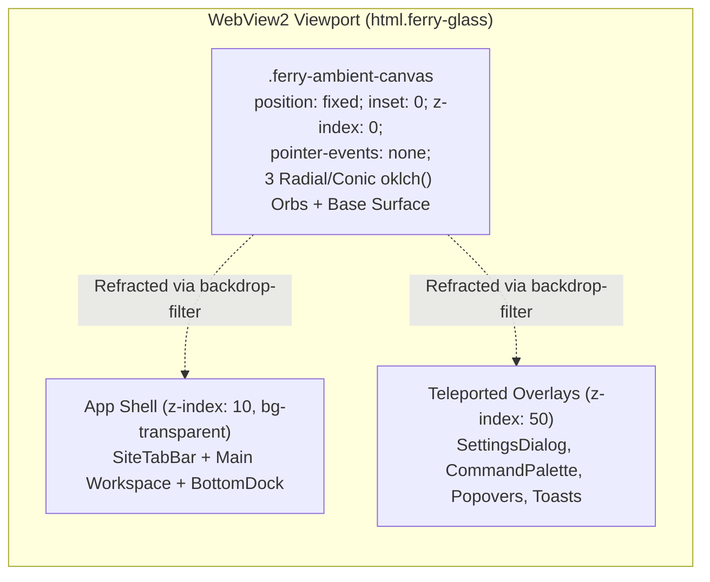
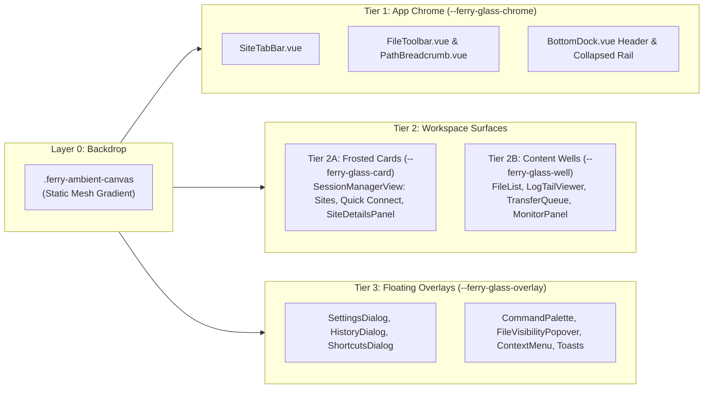

# 01: Visual direction and minimalist glassmorphism philosophy

- Parent entrypoint: [DESIGN.md](../../DESIGN.md)
- Design spec: [2026-11-18-glassmorphism-ui-research-design.md](../superpowers/specs/2026-11-18-glassmorphism-ui-research-design.md)
- Related docs: [02: Styling and tokens](./02-styling-and-tokens.md) · [03: Typography system](./03-typography-system.md) · [04: Design patterns and rollout](./04-design-patterns-and-rollout.md) · [Motion system](../motion-system.md)

---

## 1. Minimalist glassmorphism for a developer utility

Ferry is an SFTP, SSH, and live remote log-tailing desktop client. Developer tools tend toward two extremes:
1. Utilitarian flat grids: dense, opaque grey boxes with rigid 1px solid borders that feel heavy and dated.
2. Conceptual Dribbble showpieces: over-blurred, low-contrast translucent cards floating over chaotic neon wallpapers that look striking in a static screenshot but fail under 8 hours of daily terminal and file-management work.

Ferry's Modern Minimalist Glassmorphism direction combines Mikołaj Gałęziowski's optical glass hierarchy with [Arc UI's (`uiarc.dev`)](https://uiarc.dev/docs/introduction) motion philosophy, concentric surface geometry, and semantic restraint:
- Depth through translucency: floating chrome, session cards, and modal overlays behave like panes of frosted glass (`backdrop-filter: blur() saturate()`) over a calm, colour-calibrated ambient canvas.
- Restraint: every border, shadow, corner radius, and tint serves spatial hierarchy. Dense data viewports (`FileList`, `LogTailViewer`, `TerminalView`, `MonitorPanel`) sit inside high-legibility content wells (`0.82–0.92` alpha) framed by translucent chrome, which keeps contrast at WCAG 2.2 AA/AAA.
- Opt-in rollout: the `glassUiEnabled` (`html.ferry-glass`, default `false`) feature switch in Settings → Appearance lets users adopt the new visual language at their own pace, and classic mode is unchanged.

---

## 2. Case study: Mikołaj Gałęziowski (`dribbble.com/galeziowski`)

Our visual direction draws on Mikołaj Gałęziowski's glassmorphism work on Dribbble, specifically his Glassmorphism Big Sur Creative Cloud App Redesign (Dark and Light variants), Glassmorphism Big Sur Messenger App Redesign, and Smart Home / Onboarding concepts.

### Gałęziowski's four visual pillars

| Visual pillar | Gałęziowski's technique | How Ferry adapts it |
| :--- | :--- | :--- |
| 1. Multi-layered frosted planes | Separates the application shell into distinct optical planes using graduated blur radii (`12px` -> `16px` -> `24px`) and subtle opacity steps (`0.12` to `0.75`) so the user immediately perceives z-axis elevation without heavy drop-shadows. | Ferry defines a 3-tier glass hierarchy: Tier 1 App Chrome (`blur(16px)`), Tier 2 Workspace Cards & Framed Wells (`blur(12px–16px)`), and Tier 3 Floating Overlays (`blur(24px)`). |
| 2. 1px specular edge refraction | Real frosted glass catches light along its beveled top and outer edges. Gałęziowski outlines every translucent card with a `1px` semi-transparent border (`rgba(255,255,255,0.22)` in dark, `rgba(255,255,255,0.65)` in light) plus a luminous top-inner highlight (`inset 0 1px 0 rgba(255,255,255,0.28)`). | Every `.ferry-glass-card` and `.ferry-glass-overlay` pairs a `1px solid var(--ferry-glass-*-border)` outer edge with `box-shadow: var(--ferry-glass-*-highlight), var(--ferry-glass-*-shadow)` to simulate top-down studio lighting. |
| 3. Diffused chromatic sub-surface backdrops | Glass is invisible over a flat solid background. Gałęziowski places soft, out-of-focus radial mesh gradients behind the application shell so translucent panels pick up warm and cool chromatic tints as they overlap different regions of the canvas. | Ferry renders a dedicated, zero-idle-GPU `.ferry-ambient-canvas` behind `#app` using multi-stop `oklch()` radial gradients anchored to the user's chosen `accentColor` (`--ui-color-primary-500`) and complementary cool/warm ambient orbs. |
| 4. Soft ambient elevation shadows | Avoids muddy, high-opacity black shadows. Instead, uses wide, diffused ambient shadows (`0 12px 32px -4px rgba(0, 0, 0, 0.28)`) that anchor floating layers softly over the frosted plane below. | Tier 2 cards and Tier 3 modals use multi-layered ambient shadows tuned independently for Light mode (`rgba(15, 23, 42, 0.07)`) and Dark mode (`rgba(0, 0, 0, 0.42)`). |

### Restraint lessons applied to Ferry
While Gałęziowski's Dribbble shots sometimes use low-opacity (`0.15` to `0.25`) cards over saturated backgrounds for maximum showcase drama, a production SFTP client displaying thousands of filenames, permissions (`drwxr-xr-x`), and log lines requires a higher micro-tint floor:
- Showcase cards (`SessionManagerView`): can embrace lower opacity (`0.60` Dark / `0.68` Light) because the card layout is spacious and the ambient mesh shines through the surrounding canvas.
- Dense data viewports (`FileList`, `LogTailViewer`): step up to high-legibility content wells (`0.78` Dark / `0.82` Light) so background color shifts never reduce character contrast below 7:1 (WCAG AAA).

---

## 3. Material physics: light mode ("Frosted Quartz") and dark mode ("Smoked Obsidian")

Translucent materials behave differently in light and dark environments. Inverting background colors produces muddy grey glass in light mode or washed-out milky panels in dark mode.

| Material property | Light Mode: "Frosted Quartz" (`html.ferry-glass`) | Dark Mode: "Smoked Obsidian" (`html.dark.ferry-glass`) | Optical rationale |
| :--- | :--- | :--- | :--- |
| Base Canvas (`--ferry-canvas-base`) | `#f4f6fb` (`oklch(0.97 0.008 255)`) | `#090d16` (`oklch(0.15 0.02 260)`) | Cool porcelain base in Light prevents yellowing; deep midnight-slate in Dark gives rich depth behind smoked glass. |
| Primary Ambient Orb | `color-mix(in oklab, var(--ui-color-primary-400) 22%, transparent)` | `color-mix(in oklab, var(--ui-color-primary-500) 20%, transparent)` | Ties the entire glass atmosphere to the user's custom accent color preset or hex picker. |
| Secondary Ambient Orb | `oklch(0.85 0.10 300 / 0.16)` (Soft Lavender/Sky) | `oklch(0.35 0.14 295 / 0.18)` (Deep Indigo/Violet) | Provides subtle secondary chromatic refraction across the right pane (`Remote` / `Quick Connect`). |
| Backdrop Saturation Boost | `saturate(180%)` | `saturate(180%)` | Gaussian blur desaturates underlying colors; boosting saturation in `backdrop-filter` keeps refracted hues vibrant and crystalline. |
| Card Surface Tint (`--ferry-glass-card-bg`) | `rgba(255, 255, 255, 0.68)` | `rgba(15, 23, 42, 0.60)` | Warm white frost in Light; deep slate-tinted smoked glass in Dark. |
| Content Well Tint (`--ferry-glass-well-bg`) | `rgba(255, 255, 255, 0.82)` | `rgba(11, 15, 25, 0.78)` | High-legibility surface for virtualized file rows and log streams. |
| Outer Specular Border (`1px`) | `rgba(255, 255, 255, 0.75)` + `0 0 0 1px rgba(15, 23, 42, 0.06)` | `rgba(255, 255, 255, 0.14)` | Light mode needs both a bright inner glass rim and a hairline dark keyline to separate white glass from a light canvas. |
| Top Inner Specular Highlight | `inset 0 1px 0 0 rgba(255, 255, 255, 0.90)` | `inset 0 1px 0 0 rgba(255, 255, 255, 0.22)` | Simulates overhead light catching the top bevel of each card or dialog. |

---

## 4. Static ambient mesh canvas

Glass needs a non-uniform backdrop to refract. Ferry adds a single fixed-position `.ferry-ambient-canvas` layer directly behind the application layout inside `App.vue` when `ui.glassUiEnabled` is `true`.

### Rules for `.ferry-ambient-canvas`
1. Static at rest (zero idle GPU cost):
   - Continuous `@keyframes` animations on a background layer underneath full-screen `backdrop-filter: blur()` surfaces force Chromium/WebView2 to invalidate and re-composite every blurred layer at 60Hz even when the app is completely idle.
   - Therefore, `.ferry-ambient-canvas` is static at rest. It repaints only when the user toggles Light/Dark theme or picks a new `accentColor`.
2. Accent-reactive color:
   - The top-left radial orb (`at 12% 8%`) derives directly from `var(--ui-color-primary-500)` via `color-mix(in oklab, ...)`. When the user clicks a preset or drags the HSV picker in Settings → Appearance, the ambient glow behind the glass shifts in real time.
3. Windows 11 native titlebar blending (`--ferry-caption-bg`):
   - Because Ferry uses a native Windows titlebar (`borderless: false` in `neutralino.config.json`) colored via `DwmSetWindowAttribute(DWMWA_CAPTION_COLOR)` (`windowsWindow.ts`), the native titlebar can only paint a single opaque `0x00BBGGRR` color.
   - To prevent a harsh seam above `SiteTabBar`, the top edge of `.ferry-ambient-canvas` and `SiteTabBar` blends into `--ferry-caption-bg`, a 100% opaque color (`alpha === 255`) computed by mixing the base canvas with 6% to 8% of `--ui-color-primary-500`.

---

## 5. The 3-tier glass and content well hierarchy

To avoid Chromium's nested `backdrop-filter` compositing trap, every surface in Ferry belongs to one of three explicit elevation tiers (or an unblurred child inside a tier):

### Tiers

1. Tier 1, structural app chrome (`--ferry-glass-chrome`):
   - Components: `SiteTabBar`, `FileToolbar`, `PathBreadcrumb`, `BottomDock` tab strip, collapsed Local pane rail, and pane status footers.
   - Visuals: `backdrop-filter: blur(18px) saturate(180%)`, moderate translucency (`0.68` Light / `0.62` Dark), `1px` hairline structural dividers (`--ferry-glass-chrome-border`).
2. Tier 2A, session manager frosted cards (`--ferry-glass-card`):
   - Components: `SessionManagerView` cards (`Sites` card, `Quick Connect` card, reconnect banner, `SiteDetailsPanel` slide-over).
   - Visuals: Full Gałęziowski showcase treatment (`backdrop-filter: blur(20px) saturate(180%)`, `0.68` Light / `0.60` Dark tint, `1px` specular border + top-inner highlight, soft ambient shadow).
3. Tier 2B, high-legibility content wells (`--ferry-glass-well`):
   - Components: `FileList` virtualized viewport, `LogTailViewer` log stream, `TransferQueue` list, `ActivityPanel`, `MonitorPanel` tables, and `OpenEditsPanel`.
   - Visuals: High-opacity translucent wells (`0.82` Light / `0.78` Dark) that let some ambient warmth through while keeping >= 7:1 text contrast and 60fps virtualized scrolling (zero `backdrop-filter` on individual rows).
4. Tier 3, floating overlays and modals (`--ferry-glass-overlay`):
   - Components: `SettingsDialog`, `CommandPalette`, `HistoryDialog`, `FilePreviewDialog`, `SyncDialog`, `CompareDialog`, `ChmodDialog`, `FileVisibilityPopover`, `ContextMenu`, `DropdownMenu`, and `UToaster` notifications.
   - Visuals: Highest blur (`backdrop-filter: blur(24px) saturate(180%)`), `0.78` Light / `0.72` Dark tint, luminous `1px` border + top specular edge, and deep elevation shadow.

---

## 6. Combining with Arc UI (`uiarc.dev`): geometry, restraint, and motion on glass

Ferry keeps its minimalist glassmorphism surfaces and Nuxt UI v4 / Vue 3.5 component foundation, and adopts Arc UI's (`uiarc.dev`) approach to how surfaces nest, how semantic accents are rationed, and how glass panes move:

| Design dimension | Gałęziowski glassmorphism (Ferry materiality) | Arc UI craft principle | Combined Ferry standard |
| :--- | :--- | :--- | :--- |
| Surface materiality and shadows | 3-Tier frosted glass (`blur(16px–24px)`) + `1px` specular bevels + soft ambient elevation shadows on showcase cards & modals. | Resting interior surfaces and cards rely on clean `1px` borders with zero drop shadow, reserving shadows strictly for floating elevation layers. | Keep ambient shadows strictly on Tier 2A showcase cards (`SessionManagerView`) and Tier 3 floating overlays; keep all interior rows, wells, inputs, and grouped panes shadow-free with hairline `1px` borders. |
| Concentric corner radii | Soft rounded containers (`--ui-radius: 0.625rem` / `10px` to `12px`) that frame frosted panels cleanly. | Nested corners share a common optical center via `innerRadius = max(0px, outerRadius - padding)`. | Step down corner radii mathematically whenever nesting controls, inputs, or list wells inside cards or dialogs (e.g., `12px` card with `4px–6px` padding houses `8px` inner wells/pills). |
| Accent restraint over ambient glass | `.ferry-ambient-canvas` refracts subtle accent-tinted orbs beneath translucent chrome. | Semantic accent fills (`--accent`) are reserved for active, selected, progress, and primary emphasis, never decorative chrome. | Let `.ferry-ambient-canvas` provide atmospheric color quietly through glass; reserve solid `--ui-primary` fills strictly for primary CTAs, active selections, focus rings, and progress meters. |
| Critically damped glass motion | Static ambient backdrop at rest; smooth, calm surface transitions without GPU churn. | `bounce: 0` critically damped springs and faster exits (`140ms`) ensure state changes never overshoot or lag. | Pair translucent panes with critically damped motion (`--ferry-motion-ease-spring` / `bounce: 0`) using `opacity` and `transform` only, and never bouncing frosted glass over the ambient mesh or animating `filter: blur()`. |
