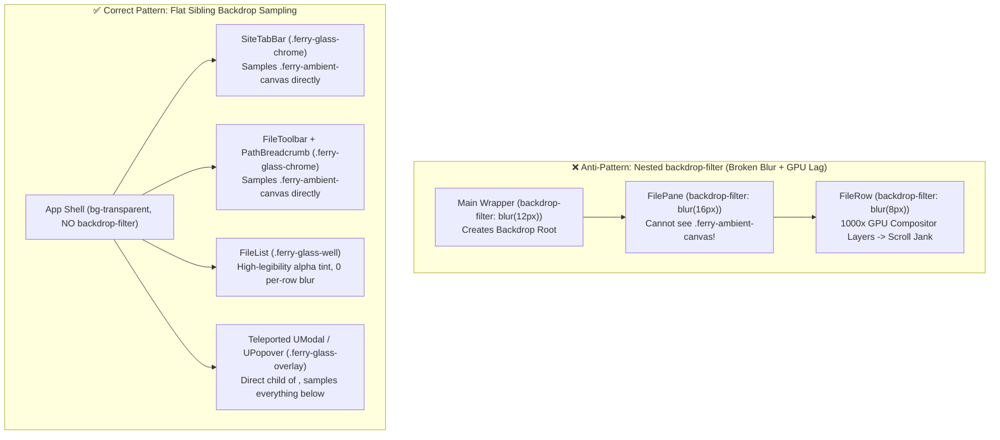

# 02: Styling, CSS tokens, and theme recipes

- Parent entrypoint: [DESIGN.md](../../DESIGN.md)
- Design spec: [2026-11-18-glassmorphism-ui-research-design.md](../superpowers/specs/2026-11-18-glassmorphism-ui-research-design.md)
- Related docs: [01: Visual direction](./01-visual-direction.md) · [03: Typography system](./03-typography-system.md) · [04: Design patterns and rollout](./04-design-patterns-and-rollout.md) · [Motion system](../motion-system.md)

---

## 1. Activation and scoping (`html.ferry-glass`)

Because the Glassmorphism UI redesign ships behind an opt-in feature switch (`glassUiEnabled`, default `false`), every CSS token override, backdrop blur, and surface utility must be scoped under `html.ferry-glass` (and `html.dark.ferry-glass` for dark mode) in [`src/renderer/src/assets/main.css`](../../src/renderer/src/assets/main.css).

- When `glassUiEnabled === false` (`<html>` without `.ferry-glass`):
  - Ferry renders 100% of its existing classic opaque palette, system font stack, and solid borders with zero visual diff.
- When `glassUiEnabled === true` (`<html class="ferry-glass">` or `<html class="dark ferry-glass">`):
  - `document.documentElement.classList.toggle('ferry-glass', enabled)` activates all `--ferry-glass-*` tokens, the `.ferry-ambient-canvas` backdrop, Nuxt UI semantic variable remappings, and the `Plus Jakarta Sans` typography stack without unmounting a single Vue component.

---

## 2. Token reference and CSS block

### Token reference

| CSS custom property | Light Mode (`html.ferry-glass`) | Dark Mode (`html.dark.ferry-glass`) | Purpose and consumers |
| :--- | :--- | :--- | :--- |
| `--ferry-canvas-base` | `#f4f6fb` | `#090d16` | Solid base floor beneath `.ferry-ambient-canvas`. |
| `--ferry-caption-bg` | `color-mix(in srgb, var(--ui-color-primary-500) 6%, #f4f6fb)` | `color-mix(in srgb, var(--ui-color-primary-500) 8%, #090d16)` | 100% opaque (`alpha === 255`) color read by `resolveCaptionColorRef()` in `ui.store.ts` to sync the Windows 11 native DWM titlebar. |
| `--ferry-glass-chrome-bg` | `rgba(248, 250, 252, 0.68)` | `rgba(13, 18, 30, 0.62)` | Tier 1 surface tint (`SiteTabBar`, `FileToolbar`, `PathBreadcrumb`, `BottomDock` bar). |
| `--ferry-glass-chrome-blur` | `blur(18px) saturate(180%)` | `blur(18px) saturate(180%)` | Tier 1 `backdrop-filter` value. |
| `--ferry-glass-chrome-border` | `rgba(15, 23, 42, 0.08)` | `rgba(255, 255, 255, 0.09)` | Hairline structural divider between chrome and content wells. |
| `--ferry-glass-card-bg` | `rgba(255, 255, 255, 0.68)` | `rgba(15, 23, 42, 0.60)` | Tier 2A showcase frosted cards (`SessionManagerView` cards, `SiteDetailsPanel`). |
| `--ferry-glass-card-blur` | `blur(20px) saturate(180%)` | `blur(20px) saturate(180%)` | Tier 2A `backdrop-filter` value. |
| `--ferry-glass-card-border` | `rgba(255, 255, 255, 0.78)` | `rgba(255, 255, 255, 0.14)` | 1px outer refractive border on frosted cards. |
| `--ferry-glass-card-highlight` | `inset 0 1px 0 0 rgba(255, 255, 255, 0.92), 0 0 0 1px rgba(15, 23, 42, 0.06)` | `inset 0 1px 0 0 rgba(255, 255, 255, 0.22)` | Top-bevel specular edge highlight (plus subtle outer keyline in Light mode). |
| `--ferry-glass-card-shadow` | `0 12px 32px -6px rgba(15, 23, 42, 0.07), 0 4px 12px -2px rgba(15, 23, 42, 0.04)` | `0 16px 36px -6px rgba(0, 0, 0, 0.42), 0 4px 12px -2px rgba(0, 0, 0, 0.28)` | Soft ambient elevation shadow under Tier 2A cards. |
| `--ferry-glass-well-bg` | `rgba(255, 255, 255, 0.82)` | `rgba(11, 15, 25, 0.78)` | Tier 2B high-legibility content well (`FileList`, `LogTailViewer`, `TransferQueue`, `MonitorPanel`). |
| `--ferry-skeleton-base` | `rgba(15, 23, 42, 0.11)` | `rgba(148, 163, 184, 0.18)` | High-contrast `<USkeleton>` base tint over translucent glass cards, wells, and modals. |
| `--ferry-skeleton-highlight` | `rgba(15, 23, 42, 0.22)` | `rgba(226, 232, 240, 0.34)` | `<USkeleton>` shimmer sweep highlight over glass surfaces. |
| `--ferry-glass-overlay-bg` | `rgba(255, 255, 255, 0.78)` | `rgba(15, 23, 42, 0.72)` | Tier 3 floating modals, command palette, popovers, context menus, toasts. |
| `--ferry-glass-overlay-blur` | `blur(24px) saturate(180%)` | `blur(24px) saturate(180%)` | Tier 3 high-refraction `backdrop-filter`. |
| `--ferry-glass-overlay-border` | `rgba(255, 255, 255, 0.82)` | `rgba(255, 255, 255, 0.18)` | 1px outer border on floating dialogs and popovers. |
| `--ferry-glass-overlay-shadow` | `0 24px 48px -12px rgba(15, 23, 42, 0.14), 0 0 0 1px rgba(15, 23, 42, 0.07)` | `0 24px 56px -12px rgba(0, 0, 0, 0.62), inset 0 1px 0 0 rgba(255, 255, 255, 0.24)` | Deep ambient shadow + specular rim for Tier 3 overlays. |

---

### CSS specification (`src/renderer/src/assets/main.css`)

```css
/* ============================================================================
   Modern Glass UI Redesign (Scoped strictly to html.ferry-glass)
   ============================================================================ */

html.ferry-glass {
  --ferry-canvas-base: #f4f6fb;
  /* 100% opaque (alpha === 255) so ui.store.ts resolveCaptionColorRef() syncs Win11 DWM caption bar */
  --ferry-caption-bg: color-mix(in srgb, var(--ui-color-primary-500) 6%, #f4f6fb);

  --ferry-ambient-mesh:
    radial-gradient(circle at 12% 8%, color-mix(in oklab, var(--ui-color-primary-400) 22%, transparent) 0%, transparent 48%),
    radial-gradient(circle at 88% 18%, oklch(0.85 0.10 300 / 0.16) 0%, transparent 52%),
    radial-gradient(circle at 52% 92%, color-mix(in oklab, var(--ui-color-primary-300) 14%, transparent) 0%, transparent 55%),
    var(--ferry-canvas-base);

  /* Tier 1: App Chrome */
  --ferry-glass-chrome-bg: rgba(248, 250, 252, 0.68);
  --ferry-glass-chrome-blur: blur(18px) saturate(180%);
  --ferry-glass-chrome-border: rgba(15, 23, 42, 0.08);

  /* Tier 2A: Showcase Frosted Cards (SessionManagerView) */
  --ferry-glass-card-bg: rgba(255, 255, 255, 0.68);
  --ferry-glass-card-blur: blur(20px) saturate(180%);
  --ferry-glass-card-border: rgba(255, 255, 255, 0.78);
  --ferry-glass-card-highlight: inset 0 1px 0 0 rgba(255, 255, 255, 0.92), 0 0 0 1px rgba(15, 23, 42, 0.06);
  --ferry-glass-card-shadow: 0 12px 32px -6px rgba(15, 23, 42, 0.07), 0 4px 12px -2px rgba(15, 23, 42, 0.04);

  /* Tier 2B: High-Legibility Content Wells (FileList, LogTailViewer, Monitor) */
  --ferry-glass-well-bg: rgba(255, 255, 255, 0.82);

  /* Tier 3: Floating Overlays (Modals vs Menus/Select Listboxes/Popovers) */
  --ferry-glass-overlay-bg: rgba(255, 255, 255, 0.86);
  --ferry-glass-menu-bg: rgba(255, 255, 255, 0.95);
  --ferry-glass-menu-nested-bg: #ffffff;
  --ferry-glass-overlay-blur: blur(24px) saturate(180%);
  --ferry-glass-overlay-border: rgba(255, 255, 255, 0.82);
  --ferry-glass-overlay-shadow:
    inset 0 1px 0 0 rgba(255, 255, 255, 0.95),
    0 0 0 1px rgba(15, 23, 42, 0.07),
    0 24px 48px -12px rgba(15, 23, 42, 0.14);

  /* Nuxt UI v4 Semantic Surface Remapping */
  --ui-radius: 0.625rem;
  --ferry-radius-card: 0.75rem;
  --ferry-radius-overlay: 0.75rem;
  --ferry-skeleton-base: rgba(15, 23, 42, 0.11);
  --ferry-skeleton-highlight: rgba(15, 23, 42, 0.22);
  --ui-bg: var(--ferry-glass-well-bg);
  --ui-bg-muted: var(--ferry-glass-chrome-bg);
  --ui-bg-elevated: var(--ferry-glass-card-bg);
  --ui-border: var(--ferry-glass-chrome-border);
  --ui-border-muted: var(--ferry-glass-chrome-border);
  --ferry-surface-bar: var(--ferry-glass-chrome-bg);
  --ferry-surface-subtle: rgba(255, 255, 255, 0.55);
}

html.dark.ferry-glass {
  --ferry-canvas-base: #090d16;
  --ferry-caption-bg: color-mix(in srgb, var(--ui-color-primary-500) 8%, #090d16);

  --ferry-ambient-mesh:
    radial-gradient(circle at 12% 8%, color-mix(in oklab, var(--ui-color-primary-500) 20%, transparent) 0%, transparent 48%),
    radial-gradient(circle at 88% 18%, oklch(0.35 0.14 295 / 0.18) 0%, transparent 52%),
    radial-gradient(circle at 52% 92%, color-mix(in oklab, var(--ui-color-primary-600) 14%, transparent) 0%, transparent 55%),
    var(--ferry-canvas-base);

  /* Tier 1: App Chrome */
  --ferry-glass-chrome-bg: rgba(13, 18, 30, 0.62);
  --ferry-glass-chrome-blur: blur(18px) saturate(180%);
  --ferry-glass-chrome-border: rgba(255, 255, 255, 0.09);

  /* Tier 2A: Showcase Frosted Cards */
  --ferry-glass-card-bg: rgba(15, 23, 42, 0.60);
  --ferry-glass-card-blur: blur(20px) saturate(180%);
  --ferry-glass-card-border: rgba(255, 255, 255, 0.14);
  --ferry-glass-card-highlight: inset 0 1px 0 0 rgba(255, 255, 255, 0.22);
  --ferry-glass-card-shadow: 0 16px 36px -6px rgba(0, 0, 0, 0.42), 0 4px 12px -2px rgba(0, 0, 0, 0.28);

  /* Tier 2B: High-Legibility Content Wells */
  --ferry-glass-well-bg: rgba(11, 15, 25, 0.78);

  /* Tier 3: Floating Overlays */
  --ferry-glass-overlay-bg: rgba(15, 23, 42, 0.82);
  --ferry-glass-menu-bg: rgba(15, 23, 42, 0.95);
  --ferry-glass-menu-nested-bg: #111827;
  --ferry-glass-overlay-blur: blur(24px) saturate(180%);
  --ferry-glass-overlay-border: rgba(255, 255, 255, 0.18);
  --ferry-glass-overlay-shadow:
    inset 0 1px 0 0 rgba(255, 255, 255, 0.24),
    0 24px 56px -12px rgba(0, 0, 0, 0.62);

  /* Nuxt UI v4 Semantic Surface Remapping */
  --ferry-skeleton-base: rgba(148, 163, 184, 0.18);
  --ferry-skeleton-highlight: rgba(226, 232, 240, 0.34);
  --ui-bg: var(--ferry-glass-well-bg);
  --ui-bg-muted: var(--ferry-glass-chrome-bg);
  --ui-bg-elevated: var(--ferry-glass-card-bg);
  --ui-border: var(--ferry-glass-chrome-border);
  --ui-border-muted: var(--ferry-glass-chrome-border);
  --ferry-surface-bar: var(--ferry-glass-chrome-bg);
  --ferry-surface-subtle: rgba(15, 23, 42, 0.48);
}

/* Reusable Surface Utility Classes (Active only when html.ferry-glass is present) */
.ferry-ambient-canvas {
  position: fixed;
  inset: 0;
  z-index: 0;
  pointer-events: none;
  background: var(--ferry-ambient-mesh);
  transition: background var(--ferry-motion-panel) var(--ferry-motion-ease-out);
}

html.ferry-glass .ferry-glass-chrome {
  background-color: var(--ferry-glass-chrome-bg);
  backdrop-filter: var(--ferry-glass-chrome-blur);
  -webkit-backdrop-filter: var(--ferry-glass-chrome-blur);
  border-color: var(--ferry-glass-chrome-border);
}

html.ferry-glass .ferry-glass-card {
  background-color: var(--ferry-glass-card-bg);
  backdrop-filter: var(--ferry-glass-card-blur);
  -webkit-backdrop-filter: var(--ferry-glass-card-blur);
  border: 1px solid var(--ferry-glass-card-border);
  border-radius: var(--ferry-radius-card);
  box-shadow: var(--ferry-glass-card-highlight), var(--ferry-glass-card-shadow);
}

html.ferry-glass .ferry-glass-well {
  background-color: var(--ferry-glass-well-bg);
}

html.ferry-glass .ferry-glass-overlay {
  background-color: var(--ferry-glass-overlay-bg);
  backdrop-filter: var(--ferry-glass-overlay-blur);
  -webkit-backdrop-filter: var(--ferry-glass-overlay-blur);
  border: 1px solid var(--ferry-glass-overlay-border);
  border-radius: var(--ferry-radius-overlay);
  box-shadow: var(--ferry-glass-overlay-shadow);
}
```

---

## 3. Nuxt UI v4 semantic variable overrides

Nuxt UI v4 components (`UCard`, `UModal`, `UPopover`, `UDropdownMenu`, `UContextMenu`, `UInput`, `USelect`, `UToaster`) compile their structural colors to CSS variables (`--ui-bg`, `--ui-bg-elevated`, `--ui-bg-muted`, `--ui-border`, `--ui-border-muted`).

Instead of deep `:deep(...)` selectors in every component, we use three rules under `html.ferry-glass`:
1. Portal overlays (`[role="dialog"]`, menus, popovers, selects, and `UToast`, excluding `UTooltip`):
   - Nuxt UI v4 (built on Reka UI) teleports modals, popovers, dropdowns, context menus, and tooltips to `<body>`.
   - `UTooltip` also renders inside `[data-reka-popper-content-wrapper]`, whereas `UToast` (`ToastRoot` inside `UToaster`) renders as an `<li role="status">` / `[data-slot="root"]` toast item rather than a Reka popper.
   - So we target `[role="dialog"]`, `[role="menu"]`, `[role="listbox"]`, and `UToaster` toast roots (`[data-slot="viewport"] > li`) for Tier 3 refractive glass while explicitly excluding `[role="tooltip"]` so small 24px tooltips stay lightweight, and using an opaque surface (`--ferry-glass-menu-nested-bg`) when a menu/select opens over an already-filtered `[role="dialog"]` to avoid Blink nested-`backdrop-filter` text bleed-through:
   ```css
   html.ferry-glass [role="dialog"],
   html.ferry-glass [data-reka-popper-content-wrapper] > :not([role="tooltip"]):not(:has([role="tooltip"])),
   html.ferry-glass [role="listbox"],
   html.ferry-glass [role="menu"],
   html.ferry-glass [data-slot="viewport"] > li {
     backdrop-filter: var(--ferry-glass-overlay-blur);
     -webkit-backdrop-filter: var(--ferry-glass-overlay-blur);
     border: 1px solid var(--ferry-glass-overlay-border);
     box-shadow: var(--ferry-glass-overlay-shadow);
   }

   html.ferry-glass [role="dialog"] {
     background-color: var(--ferry-glass-overlay-bg) !important;
     border-radius: var(--ferry-radius-overlay);
   }

   html.ferry-glass [data-reka-popper-content-wrapper] > :not([role="tooltip"]):not(:has([role="tooltip"])),
   html.ferry-glass [role="listbox"],
   html.ferry-glass [role="menu"],
   html.ferry-glass [data-slot="viewport"] > li {
     background-color: var(--ferry-glass-menu-bg) !important;
   }

   html.ferry-glass:has([role="dialog"]) [data-reka-popper-content-wrapper] > :not([role="tooltip"]):not(:has([role="tooltip"])),
   html.ferry-glass:has([role="dialog"]) [role="listbox"],
   html.ferry-glass:has([role="dialog"]) [role="menu"] {
     background-color: var(--ferry-glass-menu-nested-bg) !important;
     backdrop-filter: none;
     -webkit-backdrop-filter: none;
   }
   ```
2. Form inputs inside glass cards and overlays (`UInput`, `USelect`):
   - Inside `.ferry-glass-card` and `.ferry-glass-overlay`, text inputs and selects use a recessed semi-transparent well (`--ferry-surface-subtle`) with `1px solid var(--ferry-glass-chrome-border)` and no nested `backdrop-filter`:
   ```css
   html.ferry-glass .ferry-glass-card input,
   html.ferry-glass .ferry-glass-overlay input,
   html.ferry-glass .ferry-glass-card [role="combobox"],
   html.ferry-glass .ferry-glass-overlay [role="combobox"] {
     background-color: var(--ferry-surface-subtle);
     border-color: var(--ferry-glass-chrome-border);
   }
   ```
3. Remapping `--ui-bg*` tokens for inner containers:
   - Because `--ui-bg` maps to `var(--ferry-glass-well-bg)` and `--ui-bg-muted` maps to `var(--ferry-glass-chrome-bg)` under `html.ferry-glass`, inner containers that use `bg-default` or `bg-muted` (such as `LogTailViewer.vue:737,818`, `FilePane.vue:838`, and `EditorDialog.vue:140`) automatically inherit translucent glass-well tints without requiring manual overrides on every internal `<div>`.

---

## 4. The Chromium / WebView2 `backdrop-filter` nesting rule

> [!WARNING]
> Chromium / WebView2 compositor pitfall (Review Focus #1):
> In Blink/Chromium (WebView2), any element with `backdrop-filter` (or `opacity < 1`, `filter`, or `mask`) establishes a Backdrop Root. If a child element inside that parent also declares `backdrop-filter: blur(...)`, the child can only sample the parent's already-rendered pixels. It cannot sample `.ferry-ambient-canvas` behind the parent, and stacking multiple backdrop roots causes severe frame drops.



### Structural rules
1. Never put `backdrop-filter` on `<main>` or the root flex column in `App.vue`: Keep layout wrappers transparent (`bg-transparent`) without `backdrop-filter`, `opacity < 1`, or `will-change: transform` at rest.
2. Apply `backdrop-filter` only at the leaf container level: `SiteTabBar`, `FileToolbar`, `PathBreadcrumb`, `SessionManagerView`'s `UCard`s, `BottomDock` header, and `<body>`-teleported overlays.
3. Never apply `backdrop-filter` inside virtualized scroll containers: `FileRow.vue`, `TransferQueue.vue` rows, and `LogTailViewer.vue` lines use solid/semi-transparent `background-color` hover/selection tints (`bg-primary/15`) inside their `.ferry-glass-well` parent.

---

## 5. Accessibility fallbacks and WCAG 2.2 AA contrast

### `@media (prefers-reduced-transparency: reduce)` fallback (Review Focus #5)

Users who enable "Reduce transparency" (Windows 11 *Settings → Accessibility → Visual effects → Transparency effects: Off*) must automatically receive opaque surfaces while retaining the new `Plus Jakarta Sans` typography, rounded geometry (`--ui-radius: 0.625rem`), and specular border polish:

```css
@media (prefers-reduced-transparency: reduce) {
  html.ferry-glass {
    --ferry-glass-chrome-bg: rgba(248, 250, 252, 0.98);
    --ferry-glass-chrome-blur: none;
    --ferry-glass-card-bg: rgba(255, 255, 255, 0.98);
    --ferry-glass-card-blur: none;
    --ferry-glass-well-bg: #ffffff;
    --ferry-glass-overlay-bg: #ffffff;
    --ferry-glass-overlay-blur: none;
  }

  html.dark.ferry-glass {
    --ferry-glass-chrome-bg: rgba(13, 18, 30, 0.98);
    --ferry-glass-chrome-blur: none;
    --ferry-glass-card-bg: rgba(15, 23, 42, 0.98);
    --ferry-glass-card-blur: none;
    --ferry-glass-well-bg: #0b0f19;
    --ferry-glass-overlay-bg: #0f172a;
    --ferry-glass-overlay-blur: none;
  }
}
```

### Verified contrast ratios (worst case over the primary ambient orb)

Ferry configures Nuxt UI with `neutral: 'zinc'` (`vite.renderer.config.mts:20`) and overrides `--ui-text-muted` / `--ui-text-dimmed` in `main.css:42-52` to `var(--ui-color-neutral-600)` (`#52525b`) in Light mode and `var(--ui-color-neutral-400)` (`#a1a1aa`) in Dark mode. Because `.ferry-ambient-canvas` caps its radial orb opacity at `22%` in Light mode and `20%` in Dark mode, the worst-case composite background luminance beneath every glass tier passes WCAG 2.2 AA/AAA:

| Nuxt UI v4 Text Token | Foreground Color (`zinc` Light / Dark) | Over Tier 1 Chrome (`0.75` / `0.68`) | Over Tier 2A Card (`0.72` / `0.64`) | Over Tier 2B Content Well (`0.88` / `0.84`) | WCAG 2.2 Target |
| :--- | :--- | :--- | :--- | :--- | :--- |
| `--ui-text-highlighted` | `#18181b` (`zinc-900`) / `#fafafa` (`zinc-50`) | 14.5:1 / 15.2:1 | 14.1:1 / 14.6:1 | 15.8:1 / 16.7:1 | Passes AAA (>= 7.0:1) |
| `--ui-text` | `#3f3f46` (`zinc-700`) / `#e4e4e7` (`zinc-200`) | 8.9:1 / 11.8:1 | 8.6:1 / 11.3:1 | 9.7:1 / 12.9:1 | Passes AAA (>= 7.0:1) |
| `--ui-text-muted` | `#52525b` (`zinc-600`) / `#a1a1aa` (`zinc-400`) | 6.3:1 / 6.4:1 | 6.1:1 / 6.1:1 | 6.9:1 / 7.1:1 | Passes AA (>= 4.5:1) |
| Interactive Borders / Icons | `#71717a` (`zinc-500`) / `#71717a` (`zinc-500`) | 4.1:1 / 3.6:1 | 4.0:1 / 3.5:1 | 4.4:1 / 4.0:1 | Passes Non-Text AA (>= 3.0:1) |

---

## 6. Motion, concentric radius, and focus modality tokens (Arc UI alignment)

### 6.1 Motion and spring CSS tokens (`:root`)

All interactive transitions in [`src/renderer/src/assets/main.css`](../../src/renderer/src/assets/main.css) share one set of duration and easing tokens that combine Ferry's desktop baseline with Arc UI's critically damped `linear()` spring and faster-exit timing model (see [Motion system](../motion-system.md) for behavioral rules):

| CSS Token | Value | Purpose |
| :--- | :--- | :--- |
| `--ferry-motion-instant` | `100ms` | Immediate `:active` press scale and state snap. |
| `--ferry-motion-fast` | `120ms` | Fade transitions, hover tints, micro-feedback. |
| `--ferry-motion-exit` | `140ms` | Departing modals, popovers, toasts, and dock panels. |
| `--ferry-motion-standard` | `170ms` | Dock panel content, tab underline indicators, inline form slides. |
| `--ferry-motion-panel` | `210ms` | `BottomDock` expand/collapse, `SiteDetailsPanel` slide-over, ambient mesh transitions. |
| `--ferry-motion-considered` | `360ms` | Deliberate multi-stage reveals, SVG checkmark stroke draw, morph completion. |
| `--ferry-motion-spring` | `440ms` | Duration paired exclusively with `--ferry-motion-ease-spring`. |
| `--ferry-motion-ease-emphasized` | `cubic-bezier(0.16, 1, 0.3, 1)` | Panel entrances, active indicators, rising elements. |
| `--ferry-motion-ease-standard` | `cubic-bezier(0.22, 1, 0.36, 1)` | Balanced general UI movement. |
| `--ferry-motion-ease-out` | `cubic-bezier(0.2, 0.8, 0.2, 1)` | Content settling, ambient mesh transitions. |
| `--ferry-motion-ease-exit` | `cubic-bezier(0.7, 0, 0.84, 0)` | Fast exit acceleration for closing overlays and panels. |
| `--ferry-motion-ease-in-out` | `cubic-bezier(0.65, 0, 0.35, 1)` | Symmetric on-screen state transitions. |
| `--ferry-motion-ease-spring` | `linear(0, 0.0213, 0.0739, ... 1)` | Critically damped CSS spring (`bounce: 0`), zero state overshoot. |

```css
:root {
  --ferry-motion-instant: 100ms;
  --ferry-motion-fast: 120ms;
  --ferry-motion-exit: 140ms;
  --ferry-motion-standard: 170ms;
  --ferry-motion-panel: 210ms;
  --ferry-motion-considered: 360ms;
  --ferry-motion-spring: 440ms;

  --ferry-motion-ease-out: cubic-bezier(0.2, 0.8, 0.2, 1);
  --ferry-motion-ease-emphasized: cubic-bezier(0.16, 1, 0.3, 1);
  --ferry-motion-ease-standard: cubic-bezier(0.22, 1, 0.36, 1);
  --ferry-motion-ease-exit: cubic-bezier(0.7, 0, 0.84, 0);
  --ferry-motion-ease-in-out: cubic-bezier(0.65, 0, 0.35, 1);
  --ferry-motion-ease-spring: linear(
    0, 0.0213, 0.0739, 0.1443, 0.2235, 0.305, 0.3849, 0.4606, 0.5305,
    0.594, 0.6508, 0.7011, 0.7452, 0.7836, 0.8168, 0.8454, 0.8699,
    0.8907, 0.9084, 0.9234, 0.9361, 0.9467, 0.9557, 0.9632, 0.9694,
    0.9747, 0.979, 0.9826, 0.9857, 0.9882, 0.9902, 0.992, 0.9934,
    0.9946, 0.9955, 0.9963, 1
  );
}
```

### 6.2 Concentric corner radius scale

Nested containers obey the geometric rule $R_{\text{inner}} = \max(0\text{px}, R_{\text{outer}} - \text{Padding})$ so inner controls and outer frosted frames share the same curvature center:

| Surface Layer | Outer Radius | Typical Container Padding | Nested Inner Radius |
| :--- | :--- | :--- | :--- |
| Tier 2A Card / Tier 3 Overlay | `0.75rem` (`12px`) / `var(--ui-radius)` (`10px`) | `4px` to `6px` | `0.5rem` (`8px`) / `0.375rem` (`6px`) |
| Grouped Control / Segmented Shell | `0.5rem` (`8px`) | `2px` to `3px` | `0.375rem` (`6px`) / `0.3125rem` (`5px`) |
| Compact Badge / Tag / `<kbd>` | `0.375rem` (`6px`) | `2px` | `0.25rem` (`4px`) |

### 6.3 Pointer and keyboard focus rings, and `aria-busy`

- Focus rings by modality: Pointer interactions (`:focus:not(:focus-visible)`) draw zero focus outline so clicking buttons, site rows, or tabs never leaves a lingering ring. Keyboard navigation (`:focus-visible`) applies a `2px solid var(--ui-primary)` outline with `outline-offset: 2px`.
- Focus during async operations: Loading buttons (e.g., `"Connecting..."`, `"Saving..."`) emit `aria-busy="true"` while pending (using `:aria-busy="flag || undefined"` so idle buttons stay clean). Note that Nuxt UI `<UButton :loading="true">` sets native `disabled` on the underlying `<button>` automatically; custom non-`<UButton>` triggers should pair `aria-busy="true"` with `aria-disabled="true"` rather than raw HTML `disabled` whenever focus must remain pinned.

### 6.4 Popup-anchor press guard and pointer-fine hover guard recipes

```css
/* Suppress active scale when a button is disabled or anchors an open/popup overlay */
.ferry-dock-tab:active:not(:disabled):not([aria-disabled='true']):not([aria-haspopup]):not([data-state='open']):not([aria-expanded='true']),
.ferry-pressable:active:not(:disabled):not([aria-disabled='true']):not([aria-haspopup]):not([data-state='open']):not([aria-expanded='true']) {
  transform: scale(0.975);
}

/* Prevent sticky hover states on touch/hybrid Windows screens */
@media (hover: hover) and (pointer: fine) {
  html.ferry-glass .ferry-glass-inactive-tab:hover {
    background-color: var(--ferry-glass-tab-hover-bg);
  }
}
```
