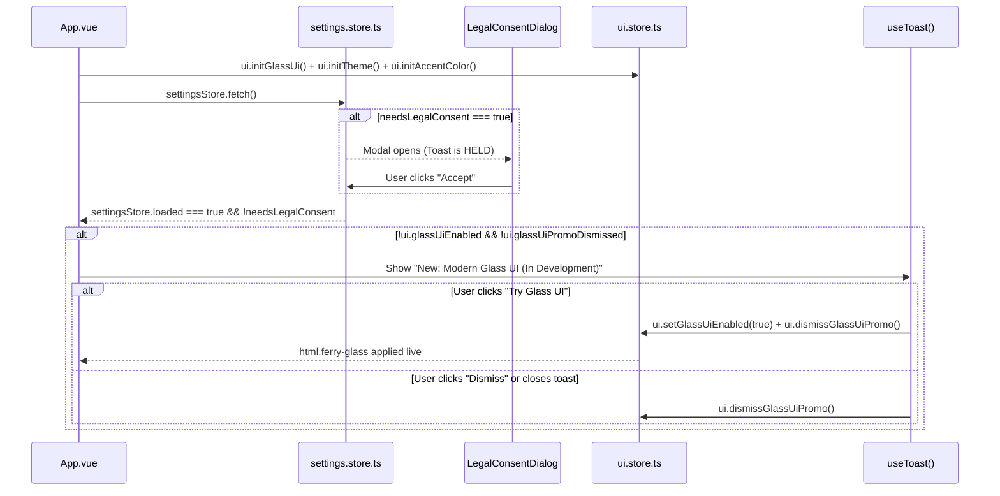

# 04 — Component Design Patterns, Feature Switch & Notification Blueprint

- **Parent Entrypoint:** [DESIGN.md](../../DESIGN.md)
- **Design Spec:** [2026-11-18-glassmorphism-ui-research-design.md](../superpowers/specs/2026-11-18-glassmorphism-ui-research-design.md)
- **Related Docs:** [01 — Visual Direction](./01-visual-direction.md) · [02 — Styling & Tokens](./02-styling-and-tokens.md) · [03 — Typography System](./03-typography-system.md) · [Motion System](../motion-system.md)

---

## 1. Component-by-Component Glass Pattern Catalog

This section maps every major Ferry view and component to its exact elevation tier, CSS class recipe, and compositor boundary under `html.ferry-glass`.

### Summary Component Map

| Component / File | Elevation Tier | Glass Utility / Token | Key Visual & Structural Rules under `html.ferry-glass` |
| :--- | :--- | :--- | :--- |
| [`App.vue`](../../src/renderer/src/App.vue) | Layer 0 + Wrapper | `.ferry-ambient-canvas` + `bg-transparent` | Renders `<div v-if="ui.glassUiEnabled" class="ferry-ambient-canvas" aria-hidden="true" />` behind the root flex column; switches root wrapper from `bg-default` to `bg-transparent` when `ui.glassUiEnabled` is `true`. **Never** puts `backdrop-filter` on `<main>`. |
| [`SiteTabBar.vue`](../../src/renderer/src/components/shell/SiteTabBar.vue) | Tier 1 Chrome | `.ferry-glass-chrome` | Header switches from `bg-muted` to `.ferry-glass-chrome`. Active `.ferry-site-tab` uses `.ferry-glass-card` top-bevel highlight; inactive tabs are transparent with `hover:bg-default/40`. |
| [`SessionManagerView.vue`](../../src/renderer/src/components/sessions/SessionManagerView.vue) | Tier 2A Frosted Cards | `.ferry-glass-card` | Outer scroll container is `bg-transparent` so `.ferry-ambient-canvas` shines around the cards. Both `Sites` and `Quick Connect` `<UCard>` components (plus the reconnect banner and [`SiteDetailsPanel.vue`](../../src/renderer/src/components/sessions/SiteDetailsPanel.vue)) apply `.ferry-glass-card`. |
| [`SiteRow.vue`](../../src/renderer/src/components/sessions/SiteRow.vue) | Child of Tier 2A | No `backdrop-filter` | Uses translucent hover (`hover:bg-default/45`) and selected pill (`bg-primary/15 ring-1 ring-primary/35`) inside the parent `.ferry-glass-card`. |
| [`FilePane.vue`](../../src/renderer/src/components/files/FilePane.vue) | Container | `bg-transparent` | Acts as a flex layout shell (`border-r border-[var(--ferry-glass-chrome-border)]`) without its own `backdrop-filter` so child chrome and wells sample cleanly. |
| [`FileToolbar.vue`](../../src/renderer/src/components/files/FileToolbar.vue) & [`PathBreadcrumb.vue`](../../src/renderer/src/components/files/PathBreadcrumb.vue) | Tier 1 Chrome | `.ferry-glass-chrome` | Translucent frosted header bars above each file pane with `1px` bottom border (`var(--ferry-glass-chrome-border)`). |
| [`FileList.vue`](../../src/renderer/src/components/files/FileList.vue) | Tier 2B Content Well | `.ferry-glass-well` | High-legibility translucent well (`0.88` Light / `0.84` Dark). Column header row uses `bg-muted/60 backdrop-blur-md`. |
| [`FileRow.vue`](../../src/renderer/src/components/files/FileRow.vue) | Virtualized Row | **Zero `backdrop-filter`** | **Never** apply `backdrop-filter` to virtualized rows. Selected rows use `bg-primary/14`, hover rows use `hover:bg-muted/50`, and size/date cells enforce `tabular-nums`. |
| [`BottomDock.vue`](../../src/renderer/src/components/shell/BottomDock.vue) | Tier 1 + Tier 2B | `.ferry-glass-chrome` (tab bar) + `.ferry-glass-well` (panels) | Dock tab strip and collapsed right rail use `.ferry-glass-chrome`; `TransferQueue`, `ActivityPanel`, `LogTailViewer`, `MonitorPanel`, and `OpenEditsPanel` sit in `.ferry-glass-well`. |
| [`TerminalView.vue`](../../src/renderer/src/components/terminal/TerminalView.vue) | WebGL Canvas | Opaque / `0.90` Default Scheme | Preserves `@xterm/addon-webgl` performance and all 9 terminal schemes in `terminalAppearance.ts`. Only the default `Ferry` scheme receives a subtle harmonized dark/light slate background (`#0b0f19` / `#f8fafc`). |
| [`SettingsDialog.vue`](../../src/renderer/src/components/shell/SettingsDialog.vue) & All Modals/Popovers | Tier 3 Overlay | `.ferry-glass-overlay` | Teleported `[role="dialog"]` and `[data-reka-popper-content-wrapper]` surfaces automatically receive `blur(24px) saturate(180%)`, 1px specular border, and deep ambient shadow. |

---

### Detailed Component Blueprints

#### 1. `App.vue` — Root Canvas & Layout Wrapper
In [`src/renderer/src/App.vue`](../../src/renderer/src/App.vue), insert `.ferry-ambient-canvas` inside `<UApp>` and make the root flex container `bg-transparent` when `ui.glassUiEnabled` is active:

```vue
<template>
  <UApp
    :locale="appLocale"
    :toaster="{
      position: 'bottom-right',
      duration: 3500,
      max: 3,
      expand: false,
      ui: { viewport: toasterViewportClass }
    }"
  >
    <div v-if="ui.glassUiEnabled" class="ferry-ambient-canvas" aria-hidden="true" />
    <div
      class="relative z-10 flex h-screen flex-col text-default"
      :class="ui.glassUiEnabled ? 'bg-transparent' : 'bg-default'"
    >
      <SiteTabBar />
      <!-- Existing <main> and connected/picker views unchanged -->
```

#### 2. `SessionManagerView.vue` — Gałęziowski Showcase Layout
When disconnected, `SessionManagerView.vue` is the hero showcase for Mikołaj Gałęziowski's glassmorphism aesthetic:
- Outer wrapper (`div.flex.h-full...`): switches `bg-default` to `:class="ui.glassUiEnabled ? 'bg-transparent' : 'bg-default'"` so the radial ambient mesh surrounds the cards.
- `Sites` `<UCard>` and `Quick Connect` `<UCard>`: add `:class="ui.glassUiEnabled ? 'ferry-glass-card' : ''"` so both cards float as frosted quartz/obsidian slabs with `1px` top-bevel highlights.

---

## 2. Settings Feature Switch Architecture (`ui.store.ts` & `SettingsDialog.vue`)

### State & Persistence Specification (`src/renderer/src/stores/ui.store.ts`)

1. **Storage Keys & Defaults:**
   ```ts
   const GLASS_UI_KEY = 'ferry:ui:glassUi'
   const GLASS_PROMO_DISMISSED_KEY = 'ferry:ui:glassUiPromoDismissed'

   function loadGlassUiEnabled(): boolean {
     return readStored(GLASS_UI_KEY) === 'true' // Default is strictly false
   }

   function loadGlassUiPromoDismissed(): boolean {
     return readStored(GLASS_PROMO_DISMISSED_KEY) === 'true'
   }
   ```
2. **DOM Class & Windows 11 Native Titlebar Sync (`resolveCaptionColorRef` — Review Focus #2):**
   - Update `resolveCaptionColorRef(theme: Theme, glassUiEnabled = false)` in `ui.store.ts` to read `--ferry-caption-bg` first when `glassUiEnabled` is `true` (falling back to `--ui-bg-muted`).
   - Because `--ferry-caption-bg` is defined using `color-mix(in srgb, var(--ui-color-primary-500) 6%, #f4f6fb)` (100% opaque, `alpha === 255`), the offscreen 1x1 `<canvas>` pixel check (`if (a !== 255) return fallback`) succeeds and passes the exact accent-tinted COLORREF to `INVOKE_CHANNELS.windowSyncTheme`.
   - Call `void applyTheme(this.theme)` inside `setGlassUiEnabled(enabled)` and `setAccentColor(hex)` so toggling Glass UI or changing the accent color updates the Windows 11 native titlebar immediately.

```ts
function applyGlassUiClass(enabled: boolean): void {
  if (typeof document !== 'undefined') {
    document.documentElement.classList.toggle('ferry-glass', enabled)
  }
}
```

3. **Store Actions (`ui.store.ts`):**
   ```ts
   initGlassUi(): void {
     applyGlassUiClass(this.glassUiEnabled)
   },

   setGlassUiEnabled(enabled: boolean): void {
     this.glassUiEnabled = enabled
     localStorage.setItem(GLASS_UI_KEY, String(enabled))
     applyGlassUiClass(enabled)
     void applyTheme(this.theme)
   },

   dismissGlassUiPromo(): void {
     this.glassUiPromoDismissed = true
     localStorage.setItem(GLASS_PROMO_DISMISSED_KEY, 'true')
   }
   ```

---

### Settings UI Specification (`src/renderer/src/components/shell/SettingsDialog.vue`)

Place the feature switch at the **top of the Appearance tab** (`#settings-panel-appearance`) inside `SettingsDialog.vue` so users opening Settings immediately spot the preview toggle:

```vue
<SettingsRow
  label="Modern Glass UI"
  description="Translucent frosted-glass surfaces, ambient mesh backdrop, and Plus Jakarta Sans typography."
>
  <template #label>
    <div class="flex items-center gap-2">
      <span>Modern Glass UI</span>
      <UBadge color="primary" variant="subtle" size="xs">In Development</UBadge>
    </div>
  </template>
  <USwitch
    :model-value="ui.glassUiEnabled"
    aria-label="Modern Glass UI (In Development)"
    @update:model-value="(v: boolean) => {
      ui.setGlassUiEnabled(v)
      ui.dismissGlassUiPromo()
    }"
  />
</SettingsRow>
```
*(Note: If `SettingsRow.vue` uses a `label` prop without a `#label` slot, add an optional `badge?: string` prop or `<slot name="label">` to `SettingsRow.vue` while keeping existing callers unchanged).*

---

## 3. One-Time User Discovery Notification (`App.vue`)

To let existing and new users know that the **Modern Glass UI** preview is available to test—without interrupting first-run legal consent or nagging them on every launch—`App.vue` triggers a one-time Nuxt UI toast.

### Lifecycle & Legal-Consent Gating (Review Focus #3)



### Exact Notification Implementation (`src/renderer/src/App.vue`)

```ts
let promoToastShown = false

watch(
  [() => settingsStore.loaded, needsLegalConsent],
  ([loaded, consentNeeded]) => {
    if (!loaded || consentNeeded || promoToastShown) return
    if (ui.glassUiEnabled || ui.glassUiPromoDismissed) return
    promoToastShown = true

    const { id } = toast.add({
      title: 'Modern Glass UI (In Development)',
      description: 'Try Ferry’s new minimalist translucent design in Settings → Appearance.',
      icon: 'i-lucide-sparkles',
      color: 'primary',
      duration: 12000,
      onOpenChange: (open: boolean) => {
        if (!open) {
          ui.dismissGlassUiPromo()
        }
      },
      actions: [
        {
          label: 'Try Glass UI',
          color: 'primary',
          variant: 'solid',
          onClick: () => {
            ui.setGlassUiEnabled(true)
            ui.dismissGlassUiPromo()
            toast.remove(id)
            notify.success(
              'Modern Glass UI enabled',
              'You can switch back anytime in Settings → Appearance.'
            )
          }
        },
        {
          label: 'Dismiss',
          color: 'neutral',
          variant: 'ghost',
          onClick: () => {
            ui.dismissGlassUiPromo()
            toast.remove(id)
          }
        }
      ]
    })
  },
  { immediate: true }
)
```

---

## 4. Performance, Motion & Accessibility Guardrails Checklist

Before any Phase 2 implementation PR is marked complete, verify every item in this checklist:

1. **Zero Regression When Disabled (`glassUiEnabled === false`):**
   - With `ferry:ui:glassUi` unset or `'false'`, `<html>` does not have `.ferry-glass`, `.ferry-ambient-canvas` is not mounted in the DOM, and computed styles match classic Ferry.
2. **Virtualized List Integrity (`FileList.vue` & `TransferQueue.vue`):**
   - `FileRow.vue` and `TransferQueue.vue` items have **zero** `backdrop-filter`, `filter`, or `box-shadow` properties. Scrolling a 10,000-entry remote directory maintains a locked 60fps.
3. **`TerminalView.vue` & `xterm.js` WebGL Preservation (Review Focus #4):**
   - Toggling `ui.setGlassUiEnabled(true/false)` never unmounts or re-keys `BottomDock.vue` or `TerminalView.vue` (`v-show` invariant in `App.vue` is strictly preserved).
   - `.xterm` canvas never has `backdrop-filter` applied to it.
4. **Motion System Alignment (`docs/motion-system.md`):**
   - All glass transitions reuse `--ferry-motion-fast` (`120ms`), `--ferry-motion-standard` (`170ms`), and `--ferry-motion-panel` (`210ms`).
   - Pointer drag-resizing of `FilePane` splitter or `BottomDock` height disables transitions during drag frames (`!transition-none`).
5. **OS Accessibility Media Queries:**
   - `@media (prefers-reduced-motion: reduce)` collapses all transition durations to `0.01ms`.
   - `@media (prefers-reduced-transparency: reduce)` disables all `backdrop-filter` blurs and raises surface alpha to `>= 0.98`.
