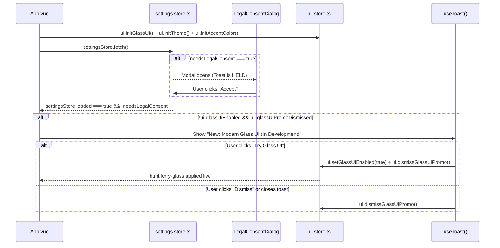

# 04: Component design patterns, feature switch, and notification

- Parent entrypoint: [DESIGN.md](../../DESIGN.md)
- Design spec: [2026-11-18-glassmorphism-ui-research-design.md](../superpowers/specs/2026-11-18-glassmorphism-ui-research-design.md)
- Related docs: [01: Visual direction](./01-visual-direction.md) · [02: Styling and tokens](./02-styling-and-tokens.md) · [03: Typography system](./03-typography-system.md) · [Motion system](../motion-system.md)

---

## 1. Glass patterns by component

This section maps each major view and component to its elevation tier, CSS classes, and compositor boundary under `html.ferry-glass`.

### Component map

| Component / file | Elevation tier | Glass utility / token | Visual and structural rules under `html.ferry-glass` |
| :--- | :--- | :--- | :--- |
| [`App.vue`](../../src/renderer/src/App.vue) | Layer 0 + Wrapper | `.ferry-ambient-canvas` + `bg-transparent` | Renders `<div v-if="ui.glassUiEnabled" class="ferry-ambient-canvas" aria-hidden="true" />` behind the root flex column; switches root wrapper from `bg-default` to `bg-transparent` when `ui.glassUiEnabled` is `true`. Never puts `backdrop-filter` on `<main>`. |
| [`SiteTabBar.vue`](../../src/renderer/src/components/shell/SiteTabBar.vue) | Tier 1 Chrome | `.ferry-glass-chrome` | Header switches from `bg-muted` to `.ferry-glass-chrome`. Active `.ferry-site-tab` uses `bg-default` (which resolves to `--ferry-glass-well-bg`) plus an inset top-bevel `box-shadow` highlight (`inset 0 1px 0 rgba(255,255,255,0.22)`) without applying `.ferry-glass-card` (avoiding nested `backdrop-filter` and preserving `border-t-2` environment borders). Inactive tabs are transparent with `hover:bg-default/40`. |
| [`SessionManagerView.vue`](../../src/renderer/src/components/sessions/SessionManagerView.vue) | Tier 2A Frosted Cards | `.ferry-glass-card` | Outer scroll container is `bg-transparent` so `.ferry-ambient-canvas` shines around the cards. Both `Sites` and `Quick Connect` `<UCard>` components (plus the reconnect banner and [`SiteDetailsPanel.vue`](../../src/renderer/src/components/sessions/SiteDetailsPanel.vue)) apply `.ferry-glass-card`. |
| [`SiteRow.vue`](../../src/renderer/src/components/sessions/SiteRow.vue) | Child of Tier 2A | No `backdrop-filter` | Uses translucent hover (`hover:bg-default/45`) and selected pill (`bg-primary/15 ring-1 ring-primary/35`) inside the parent `.ferry-glass-card`. |
| [`FilePane.vue`](../../src/renderer/src/components/files/FilePane.vue) | Container | `bg-transparent` | Acts as a flex layout shell (`border-r border-[var(--ferry-glass-chrome-border)]`) without its own `backdrop-filter` so child chrome and wells sample cleanly. |
| [`FileToolbar.vue`](../../src/renderer/src/components/files/FileToolbar.vue) & [`PathBreadcrumb.vue`](../../src/renderer/src/components/files/PathBreadcrumb.vue) | Tier 1 Chrome | `.ferry-glass-chrome` | Translucent frosted header bars above each file pane with `1px` bottom border (`var(--ferry-glass-chrome-border)`). Strip the redundant inner `backdrop-blur-xs` from `PathBreadcrumb.vue:182` so it does not nest a second blur inside `.ferry-glass-chrome`. |
| [`FileList.vue`](../../src/renderer/src/components/files/FileList.vue) | Tier 2B Content Well | `.ferry-glass-well` | High-legibility translucent well (`0.82` Light / `0.78` Dark). Column header row uses `bg-muted/60` (no nested `backdrop-blur`). |
| [`FileRow.vue`](../../src/renderer/src/components/files/FileRow.vue) | Virtualized Row | Zero `backdrop-filter` | Never apply `backdrop-filter` to virtualized rows. Selected rows preserve active vs. inactive pane distinction (`bg-primary/14` + `shadow-[inset_2px_0_0_var(--ui-primary)]`), hover rows use `hover:bg-muted/50`, and size/date cells enforce `tabular-nums`. |
| [`BottomDock.vue`](../../src/renderer/src/components/shell/BottomDock.vue) | Tier 1 + Tier 2B | `.ferry-glass-chrome` (tab bar) + `.ferry-glass-well` (panels) | Dock tab strip and collapsed right rail use `.ferry-glass-chrome`; `TransferQueue`, `ActivityPanel`, `LogTailViewer`, `MonitorPanel`, and `OpenEditsPanel` sit in `.ferry-glass-well`. Strip `backdrop-blur-xs` from virtualized log rows in `LogTailViewer.vue:959` (and `backdrop-blur-md` on line 1036) to eliminate per-row compositor layers. |
| [`TerminalView.vue`](../../src/renderer/src/components/terminal/TerminalView.vue) | WebGL Canvas | 100% opaque default scheme | Preserves `@xterm/addon-webgl` (`allowTransparency: false`) performance and all 9 terminal schemes in `terminalAppearance.ts`. When `glassUiEnabled` is `true`, the default `Ferry` scheme uses 100% opaque `#0b0f19` (Dark) / `#f8fafc` (Light) harmonized to the glass well, and `terminalStreams.applyAppearance()` is called on toggle. |
| [`SettingsDialog.vue`](../../src/renderer/src/components/shell/SettingsDialog.vue) & All Modals/Popovers | Tier 3 Overlay | `.ferry-glass-overlay` | Teleported `[role="dialog"]` and `[data-reka-popper-content-wrapper]` surfaces automatically receive `blur(24px) saturate(180%)`, 1px specular border, and deep ambient shadow. |

---

### Component details

#### 1. `App.vue`: root canvas and layout wrapper
In [`src/renderer/src/App.vue`](../../src/renderer/src/App.vue), insert `.ferry-ambient-canvas` inside `<UApp>` and make the root flex container `bg-transparent` when `ui.glassUiEnabled` is active:

```vue
<template>
  <UApp
    :locale="appLocale"
    :toaster="{
      position: 'bottom-right',
      duration: 3500,
      max: 3,
      expand: false,
      ui: { viewport: toasterViewportClass }
    }"
  >
    <div v-if="ui.glassUiEnabled" class="ferry-ambient-canvas" aria-hidden="true" />
    <div
      class="relative z-10 flex h-screen flex-col text-default"
      :class="ui.glassUiEnabled ? 'bg-transparent' : 'bg-default'"
    >
      <SiteTabBar />
      <!-- Existing <main> and connected/picker views unchanged -->
```

#### 2. `SessionManagerView.vue`: showcase layout
When disconnected, `SessionManagerView.vue` is the showcase for Mikołaj Gałęziowski's glassmorphism aesthetic:
- Outer wrapper (`div.flex.h-full...`): switches `bg-default` to `:class="ui.glassUiEnabled ? 'bg-transparent' : 'bg-default'"` so the radial ambient mesh surrounds the cards.
- `Sites` `<UCard>` and `Quick Connect` `<UCard>`: add `:class="ui.glassUiEnabled ? 'ferry-glass-card' : ''"` so both cards float as frosted quartz/obsidian slabs with `1px` top-bevel highlights.

---

## 2. Settings feature switch (`ui.store.ts` & `SettingsDialog.vue`)

### State and persistence (`src/renderer/src/stores/ui.store.ts`)

1. Storage keys and defaults:
   ```ts
   const GLASS_UI_KEY = 'ferry:ui:glassUi'
   const GLASS_PROMO_DISMISSED_KEY = 'ferry:ui:glassUiPromoDismissed'

   function loadGlassUiEnabled(): boolean {
     return readStored(GLASS_UI_KEY) === 'true' // Default is strictly false
   }

   function loadGlassUiPromoDismissed(): boolean {
     return readStored(GLASS_PROMO_DISMISSED_KEY) === 'true'
   }
   ```
2. DOM class and Windows 11 native titlebar sync (`resolveCaptionColorRef`, Review Focus #2):
   - Startup order (`App.vue`): Always call `ui.initGlassUi()` and `ui.initAccentColor()` before `const initialThemeSync = ui.initTheme()` in `App.vue` so `html.ferry-glass` and `--ui-color-primary-500` are set on `document.documentElement` before `resolveCaptionColorRef()` samples `--ferry-caption-bg`.
   - Update `resolveCaptionColorRef(theme: Theme)` in `ui.store.ts` to check `document.documentElement.classList.contains('ferry-glass')` and read `--ferry-caption-bg` first when active (falling back to `--ui-bg-muted`).
   - Because `--ferry-caption-bg` is defined using `color-mix(in srgb, var(--ui-color-primary-500) 6%, #f4f6fb)` (100% opaque, `alpha === 255`), the offscreen 1x1 `<canvas>` pixel check (`if (a !== 255) return fallback`) succeeds and passes the exact accent-tinted COLORREF to `INVOKE_CHANNELS.windowSyncTheme`.
   - Call `void applyTheme(this.theme)` inside `setGlassUiEnabled(enabled)`, and inside `setAccentColor(hex)` only when `this.glassUiEnabled` is `true` (debounced by 250ms) so dragging the HSV `ColorPicker` in `SettingsDialog.vue` does not spawn `powershell.exe` on every 100ms throttle tick.

```ts
function applyGlassUiClass(enabled: boolean): void {
  if (typeof document !== 'undefined') {
    document.documentElement.classList.toggle('ferry-glass', enabled)
  }
}
```

3. Store actions (`ui.store.ts`):
   ```ts
   initGlassUi(): void {
     applyGlassUiClass(this.glassUiEnabled)
   },

   setGlassUiEnabled(enabled: boolean): void {
     this.glassUiEnabled = enabled
     localStorage.setItem(GLASS_UI_KEY, String(enabled))
     applyGlassUiClass(enabled)
     void applyTheme(this.theme)
   },

   dismissGlassUiPromo(): void {
     this.glassUiPromoDismissed = true
     localStorage.setItem(GLASS_PROMO_DISMISSED_KEY, 'true')
   }
   ```

---

### Settings UI (`src/renderer/src/components/shell/SettingsDialog.vue`)

Place the feature switch at the top of the Appearance tab (`#settings-panel-appearance`) inside `SettingsDialog.vue` so users opening Settings see the preview toggle:

```vue
<SettingsRow
  label="Modern Glass UI"
  description="Translucent frosted-glass surfaces, ambient mesh backdrop, and Plus Jakarta Sans typography."
>
  <template #label>
    <div class="flex items-center gap-2">
      <span>Modern Glass UI</span>
      <UBadge color="primary" variant="subtle" size="xs">In Development</UBadge>
    </div>
  </template>
  <USwitch
    :model-value="ui.glassUiEnabled"
    aria-label="Modern Glass UI (In Development)"
    @update:model-value="(v: boolean) => {
      ui.setGlassUiEnabled(v)
      ui.dismissGlassUiPromo()
    }"
  />
</SettingsRow>
```
*(Note: If `SettingsRow.vue` uses a `label` prop without a `#label` slot, add an optional `badge?: string` prop or `<slot name="label">` to `SettingsRow.vue` while keeping existing callers unchanged).*

---

## 3. One-time discovery notification (`App.vue`)

To tell users the Modern Glass UI preview is available, without interrupting first-run legal consent or repeating on every launch, `App.vue` triggers a one-time Nuxt UI toast.

### Lifecycle and legal-consent gating (Review Focus #3)



### Notification implementation (`src/renderer/src/App.vue`)

Note: Uses `duration: 0` (matching `App.vue:250` and `useNotify.ts:34` for actionable prompts so the toast never auto-expires before the user sees it) and `'onUpdate:open'` (matching `@nuxt/ui` v4.9's `ToastRoot` event signature so clicking the close `X` button persists `ui.dismissGlassUiPromo()`):

```ts
let promoToastShown = false

watch(
  [() => settingsStore.loaded, needsLegalConsent],
  ([loaded, consentNeeded]) => {
    if (!loaded || consentNeeded || promoToastShown) return
    if (ui.glassUiEnabled || ui.glassUiPromoDismissed) return
    promoToastShown = true

    const { id } = toast.add({
      title: 'Modern Glass UI (In Development)',
      description: 'Try Ferry’s new minimalist translucent design in Settings → Appearance.',
      icon: 'i-lucide-sparkles',
      color: 'primary',
      duration: 0,
      'onUpdate:open': (open: boolean) => {
        if (!open) {
          ui.dismissGlassUiPromo()
        }
      },
      actions: [
        {
          label: 'Try Glass UI',
          color: 'primary',
          variant: 'solid',
          onClick: () => {
            ui.setGlassUiEnabled(true)
            ui.dismissGlassUiPromo()
            toast.remove(id)
            notify.success(
              'Modern Glass UI enabled',
              'You can switch back anytime in Settings → Appearance.'
            )
          }
        },
        {
          label: 'Dismiss',
          color: 'neutral',
          variant: 'ghost',
          onClick: () => {
            ui.dismissGlassUiPromo()
            toast.remove(id)
          }
        }
      ]
    })
  },
  { immediate: true }
)
```

---

## 4. Performance, motion, and accessibility checklist

Before any Phase 2 implementation PR is marked complete, verify every item in this checklist:

1. No regression when disabled (`glassUiEnabled === false`):
   - With `ferry:ui:glassUi` unset or `'false'`, `<html>` does not have `.ferry-glass`, `.ferry-ambient-canvas` is not mounted in the DOM, and computed styles match classic Ferry.
2. Virtualized list integrity (`FileList.vue` & `TransferQueue.vue`):
   - `FileRow.vue` and `TransferQueue.vue` items have zero `backdrop-filter`, `filter`, or `box-shadow` properties. Scrolling a 10,000-entry remote directory maintains a locked 60fps.
3. `TerminalView.vue` & `xterm.js` WebGL preservation (Review Focus #4):
   - Toggling `ui.setGlassUiEnabled(true/false)` never unmounts or re-keys `BottomDock.vue` or `TerminalView.vue` (`v-show` invariant in `App.vue` is strictly preserved).
   - `.xterm` canvas never has `backdrop-filter` applied to it.
4. Motion system alignment (`docs/motion-system.md`):
   - All glass transitions reuse `--ferry-motion-fast` (`120ms`), `--ferry-motion-standard` (`170ms`), and `--ferry-motion-panel` (`210ms`).
   - Pointer drag-resizing of `FilePane` splitter or `BottomDock` height disables transitions during drag frames (`!transition-none`).
5. OS accessibility media queries:
   - `@media (prefers-reduced-motion: reduce)` collapses all transition durations to `0.01ms`.
   - `@media (prefers-reduced-transparency: reduce)` disables all `backdrop-filter` blurs and raises surface alpha to `>= 0.98`.

---

## 5. Responsive slots, container queries, and input modality (Arc UI patterns)

### 5.1 Container-first responsiveness (`@container` and `cqi` over viewport media queries)

Viewport `@media` queries alone are not enough in a multi-pane desktop application: users freely drag the `FilePane` splitter, collapse the Local pane, open `SiteDetailsPanel`, or dock `BottomDock` to the right or bottom. A `FilePane` inside a `1440px` desktop window can easily be narrowed to `320px`. Components must adapt to their slot width via CSS container queries (`container-type: inline-size`) or `ResizeObserver`:

| Resizable slot / view | Container breakpoints | Adaptation rule |
| :--- | :--- | :--- |
| `FilePane` (`FileToolbar.vue` & `PathBreadcrumb.vue`) | `>= 580px` (`@[580px]`) | Inline single-row header with breadcrumb, vertical separator, full toolbar controls, and wider filter `<UInput>`. |
| | `480px – 579px` (`@[480px]`) | Wraps toolbar below breadcrumb while keeping `"New file"` button and inline search input visible; engages `.ferry-scroll-fade-x` on `PathBreadcrumb`. |
| | `< 480px` (`< 300px` strip) | Collapses `"New file"` into `"More actions"` dropdown, expands search below toolbar, and switches `PathBreadcrumb` (`stripWidth < 300px`) into compact root + `…` parent menu + current folder mode. |
| `SessionManagerView.vue` (`Sites` + `Quick Connect` + `SiteDetailsPanel`) | `>= 860px` (`@[860px]`) | Dual-column grid (`Sites` card alongside `Quick Connect` / `SiteDetailsPanel`) with `Sites` list capped at `@[860px]:max-h-[58vh]`. |
| | `< 860px` | Single-column stacked layout with natural full-page scrolling and `slide-up` inline swap between `Quick Connect` and `SiteDetailsPanel`. |
| `BottomDock.vue` (`TransferQueue`, `MonitorPanel`, `LogTailViewer`) | `>= 560px` (`@[560px]`) | Shows full host label beside terminal search action in dock header and session badge (`@[480px]`) on log-tail tabs. |
| | `< 500px` (`compactRightTabs`) | Collapses inactive right-dock tab labels to icon-only pills; keeps `min-h-9` (`36px`) dock header and `Ctrl+`` hint (`@[460px]`) constrained. |

- Viewport safety rules:
  - Never set `width: 100vw` on internal layout containers (prevents horizontal scrollbar overflow).
  - Floating modals, slide-overs, and popovers cap at `min(var(--modal-max-w), calc(100vw - 32px))` and `max-height: calc(100dvh - 32px)`.

### 5.2 Pointer, touch, and keyboard modality

- Hover guards: Wrap hover-only surface tints and hover-revealed icons in `@media (hover: hover) and (pointer: fine)` so touch or hybrid Windows devices never leave sticky hover states.
- Axis-locked touch and drag (`touch-action`): Pane splitters (`FilePane` divider, `BottomDock` resize handle) and HSV color pickers set `touch-action: none`; horizontal tab strips (`SiteTabBar`, `BottomDock` tabs) set `touch-action: pan-x` so horizontal drags or trackpad gestures never fight vertical scroll containers.
- Keyboard parity for every gesture and hover action: Every hover-revealed action (`SiteRow` connect/edit buttons, `FileRow` quick actions, toast actions) must remain reachable via keyboard `:focus-visible` and context menus.

---

## 6. Arc UI micro-interaction patterns by component

| Ferry component(s) | Arc UI pattern applied | Implementation standard |
| :--- | :--- | :--- |
| `SiteTabBar.vue` & `BottomDock.vue` | Shared Transform Indicator + Overflow Edge Masks + Warmup Tooltips | Animate active tab indicators via `transform` (`scale-x-100` / `scale-x-75` / `scale-x-0` and `scaleX` on `--ferry-motion-standard` + `--ferry-motion-ease-emphasized`); engage `.ferry-scroll-fade-x` edge masks + `touch-pan-x` + mouse-wheel scrolling on horizontal overflow; share a `300ms` tooltip warmup window via `<UApp :tooltip>`. |
| `FileToolbar.vue`, `SiteTabBar.vue` & `BottomDock.vue` | Tactile Press Scale + Popup-Anchor Press Guard | Apply `.ferry-pressable` (`scale(0.975)` over `--ferry-motion-instant`) on toolbar buttons while automatically suppressing `:active` shrink on disabled controls and popup triggers (`[aria-haspopup]`, `[data-state="open"]`, `[aria-expanded="true"]`). |
| Destructive Actions (`ConfirmDialog.vue`) | `280ms` Pointer Double-Click Guard | Guard `destructive: true` pointer clicks (`event.detail > 0`) for `280ms` after `<UModal>` `@enter` to prevent accidental double-click destruction while keeping keyboard (`Enter`/`Space`) confirmation instant. |
| `SettingsDialog.vue`, `CommandPalette.vue`, `FilePreviewDialog.vue` & Reka UI Portals | Aligned Keyframe Timings + Glass Skeleton Shimmer | Pair Tier 3 `.ferry-glass-overlay` with `[data-state="open"]` (`170ms` `--ferry-motion-ease-emphasized`) and `[data-state="closed"]` (`140ms` `--ferry-motion-ease-exit`) keyframe timing overrides, and use `--ferry-skeleton-base` / `--ferry-skeleton-highlight` shimmer inside glass loading states. |
| `SessionManagerView.vue` | `@container` Grid + `slide-up` Card Swap | Use `@[860px]` container queries for grid columns and `58vh` list scroll capping, `slide-up` panel swaps (`SiteDetailsPanel` / `Quick Connect`), `text-balance` / `text-pretty` empty states, and `:aria-busy` on async buttons. |
