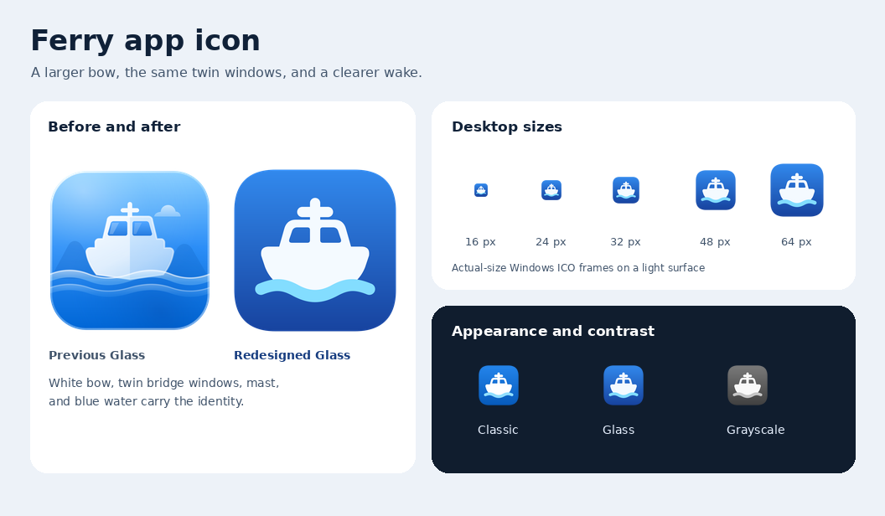

# Ferry app icon

Ferry's signature is a white vessel seen bow-on, with twin bridge windows, a short mast, and a blue wake. The refresh enlarges that silhouette and draws the wake as one ribbon with two crests. Open bridge windows carry the background color through the vessel. The deeper blue background and ice-blue wake keep the nautical palette recognizable.



## Design decisions

| Direction | Decision |
| --- | --- |
| Detailed glass scene | Clouds, shorelines, reflections, and thin rims competed with the vessel at favicon size. |
| Abstract transfer arrows | This would communicate file transfer but lose the vessel people associate with Ferry. |
| Bow-on vessel and wake | The mast, twin windows, broad bow, and blue wake carry the identity in a compact, centered shape. Classic and Glass use the same geometry with their own blue palettes. |

Apple's guidelines informed the centered composition, filled shapes, simple background, and consistency across appearances. The two foreground sources are opaque vector shapes on separate, unmasked 1024 × 1024 canvases. The Windows and renderer assets add the rounded blue tile during export. Apple platforms can apply their own masks and material effects in Icon Composer.

- [Apple Human Interface Guidelines - App icons](https://developer.apple.com/design/human-interface-guidelines/app-icons)
- [Apple Human Interface Guidelines - Branding](https://developer.apple.com/design/human-interface-guidelines/branding)
- [WWDC25 - Create icons with Icon Composer](https://developer.apple.com/videos/play/wwdc2025/361/)

## Deliverables and review

| Surface | Review |
| --- | --- |
| Taskbar, Explorer, installer, and uninstaller | Check the 16, 24, 32, 48, 64, 128, and 256 px frames in `resources/icon.ico`. At 16 px the windows should read as two openings and the wake should remain visible. |
| MSIX | Check the 44, 50, and 150 px transparent PNGs referenced by the app manifest. |
| Neutralino window, browser favicon, and in-app mark | Check the initial ICO and both appearances. The existing appearance preference selects the corresponding Classic or Glass artwork. |
| Light, dark, and monochrome review | Compare the same silhouette on light and dark backgrounds. In grayscale, the bridge, bow, and wake should still be distinct. |

## Edit and export

Edit [the vessel](../../resources/icon-layers/01-vessel.svg) and [the wake](../../resources/icon-layers/02-wake.svg) to change the geometry. Keep the shared `0 0 128 128` viewBox for both layers. Edit the palettes in [the export script](../../scripts/build-icons.mjs). With the repository's Node dependencies, Inkscape 1.4, and ImageMagick 7 installed, run:

```sh
node scripts/build-icons.mjs
```

Commit the generated assets with the source change. For Icon Composer, create a square 1024 px canvas, set a full-bleed blue background, then import the vessel and wake in that stacking order. Use the same shapes for each appearance and adjust the materials in Icon Composer.
