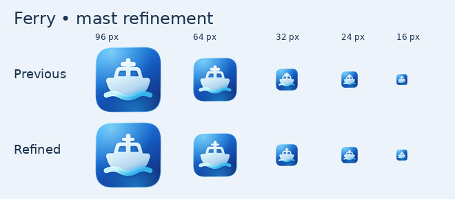

# Ferry app icon

Ferry's signature is a white vessel seen bow-on, with twin bridge windows, a short mast, and a blue wake. The refresh enlarges that silhouette and draws the wake as one ribbon with two crests. Open bridge windows carry the background color through the vessel. The deeper blue background and ice-blue wake keep the nautical palette recognizable.


The final mast has a shorter, thinner crossbar so the bridge windows draw the eye first.



## Design decisions

| Direction | Decision |
| --- | --- |
| Detailed glass scene | Clouds, shorelines, reflections, and thin rims competed with the vessel at favicon size. |
| Abstract transfer arrows | This would communicate file transfer but lose the vessel people associate with Ferry. |
| Bow-on vessel and wake | The mast, twin windows, broad bow, and blue wake carry the identity in a compact, centered shape. Classic and Glass share this geometry. Glass adds a frosted bow, translucent cyan wake, and directional edge highlights over a deep blue gradient. |

Apple's guidelines informed the centered composition, filled shapes, simple background, and consistency across appearances. The two foreground sources are opaque vector shapes on separate, unmasked 1024 × 1024 canvases. The Windows and renderer exports render a static glass treatment, with a light rim on the rounded tile and gentle shadows separating the bow and wake. In a native Apple build, Icon Composer and the OS supply the masks, glass material, and responsive lighting.

- [Apple Human Interface Guidelines - App icons](https://developer.apple.com/design/human-interface-guidelines/app-icons)
- [Apple Human Interface Guidelines - Branding](https://developer.apple.com/design/human-interface-guidelines/branding)
- [WWDC25 - Say hello to the new look of app icons](https://developer.apple.com/videos/play/wwdc2025/220/)
- [WWDC25 - Create icons with Icon Composer](https://developer.apple.com/videos/play/wwdc2025/361/)

## Deliverables and review

| Surface | Review |
| --- | --- |
| Taskbar, Explorer, installer, and uninstaller | Check the 16, 24, 32, 48, 64, 128, and 256 px frames in `resources/icon.ico`. At 16 px the windows should read as two openings and the wake should remain visible. |
| MSIX | Check the 44, 50, and 150 px transparent PNGs referenced by the app manifest. |
| Neutralino window, browser favicon, and in-app mark | Check the initial ICO and both appearances. The existing appearance preference selects the corresponding Classic or Glass artwork. |
| Light, dark, and monochrome review | Compare the same silhouette on light and dark backgrounds. In grayscale, the bridge, bow, and wake should still be distinct. |

## Edit and export

Edit [the vessel](../../resources/icon-layers/01-vessel.svg) and [the wake](../../resources/icon-layers/02-wake.svg) to change the geometry. Keep the shared `0 0 128 128` viewBox for both layers. Edit the Classic palette and Windows glass materials in [the export script](../../scripts/build-icons.mjs). With the repository's Node dependencies, Inkscape 1.4, and ImageMagick 7 installed, run:

```sh
node scripts/build-icons.mjs
```

Commit the generated assets with the source change.

## Native Apple composition

1. Create a square 1024 px canvas in Icon Composer and set a full-bleed blue gradient.
2. Import the vessel and wake as separate groups, with the wake in front. Use a frosted vessel with enough opacity to preserve the bridge windows and a slightly more translucent wake.
3. Tune edge highlights at small sizes. Use the same geometry for Default, Dark, and Mono, then preview the four Clear and Tinted appearances in Icon Composer.
